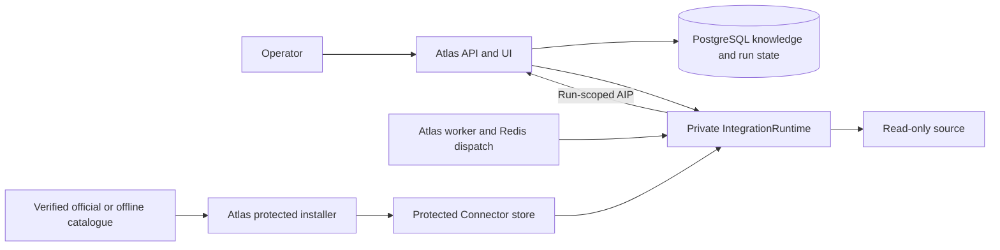
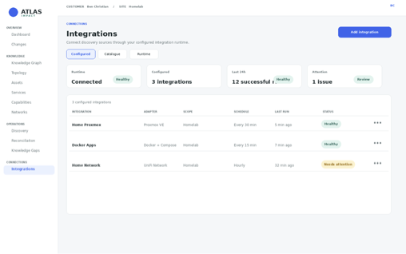
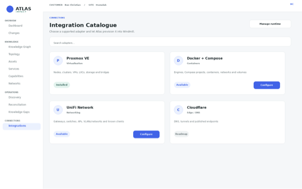
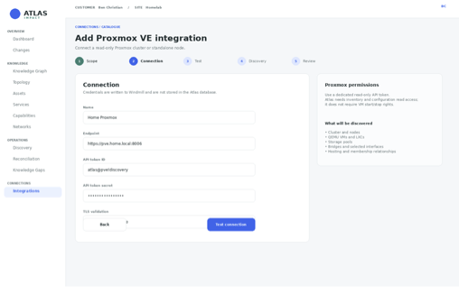
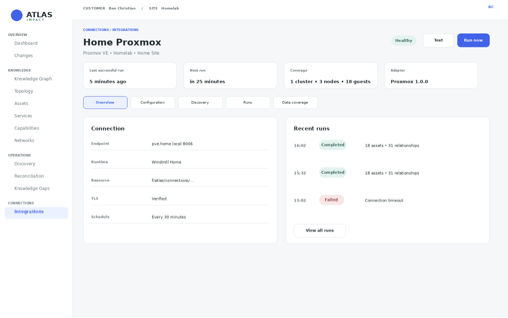
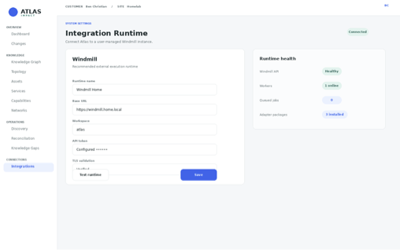

Atlas Integration Architecture & Design Specification

Catalogue-driven discovery architecture, isolated Ansible runtime,
Atlas-owned protocol and credentials, and signed Connector supply chain

Atlas Impact

11 October 2026 — repository alignment of the supplied 5 October design

**Architecture & Design Specification | Version 1.3 | Community Preview**

**Status: Accepted target architecture; I0 specification baseline.**
This is the **single active Integration design**. [v1.2](../../history/integrations/atlas-integration-architecture-v1.2.md)
is historical; its supplied UI mockups remain the implementation baseline.
The [alignment matrix](integration-alignment-matrix.md) records the inspected
repository at `90e04a76982c314fff2191e84ca6bd1a8cabcb07`, including material
legacy-policy differences. The [staged contracts](contracts/README.md) define
normative wire shapes and validation. Accepted architecture does not imply
runtime, catalogue, ingestion or vendor functionality is implemented.

I0 artifacts live only in documentation. Before I1, move the new schemas verbatim
into `atlas-connector-sdk`; that separate project becomes the **sole canonical
schema source** consumed by Atlas and `atlas-connectors`. Do not wire production
code to these staged copies or create an in-repository duplicate SDK package.

# Executive summary

Atlas already contains most of the difficult knowledge-management
foundation required for an integration platform: scoped Customers and
Sites, Assets, Networks and Interfaces, managed relationship types,
Services and Business Functions, discovery runs, data sources, evidence,
assertions, reconciliation, entity-source links, a shared operational
graph, dependency analysis, and a vendor-neutral plugin SDK. The present
gap is not another graph model. The gap is a reliable and scalable way
to connect many external systems without making the Atlas core
responsible for every vendor API.

This specification defines a homelab-first integration architecture that
can grow naturally into small-business and MSP use without making Atlas
an enterprise integration suite.

The central design decision is:

> **Atlas owns integration semantics, credentials, Atlas Integration
> Protocol (AIP), provenance, reconciliation, accepted knowledge,
> topology and the user experience. Ansible is the first reference
> execution runtime. An isolated Atlas Ansible Runtime uses Ansible
> Runner and pinned Execution Environments to consume maintained Ansible
> Collections wherever practical, then normalises their results into
> AIP.**

Ansible is deliberately separated from Atlas domain code. Atlas core
does not import `ansible-core`, does not depend on Ansible internal APIs,
and remains usable when the runtime is unavailable. The runtime is a
separate deployed process/service boundary. Docker uses a pinned container
runtime environment; native/systemd uses an equivalently pinned native
Python/Ansible/Collection environment and does not require Docker or Podman.
AIP remains runtime-neutral so a future runtime can produce the same Atlas
observations without changing the knowledge plane.

Source credentials are managed through an Atlas `SecretProvider`. The
default provider reuses Atlas's existing `ATLAS_DATA_ENCRYPTION_KEY`
lifecycle with integration-specific cryptographic context; it does not add a
second operator-managed master key. Secret values are write-only from the UI
and are materialised to a runtime job only for the lifetime of that job.
Ansible is not the system of record for credentials.

The first three reference connectors remain:

1.  **Proxmox VE** — cluster, node, VM, LXC, storage and network/bridge
    discovery.
2.  **Docker + Docker Compose** — Docker engines, Compose projects,
    containers, networks, volumes, ports and runtime relationships.
3.  **UniFi Network** — local controller/site context, gateways, switches,
    access points, Networks/VLANs and management interfaces. End-user/client
    device discovery is intentionally excluded from v1.

The release objective is not to build every possible connector. It is to
establish one runtime-neutral Connector contract, one canonical AIP
ingestion model and one reliable execution boundary, then prove them
with materially different sources. Atlas should prefer a maintained
Ansible Collection for source API interaction, own only the
source-to-AIP semantics and thin orchestration required for Atlas, and
maintain a direct vendor client only where the collection ecosystem
cannot provide the required read-only discovery.

## Recommended release outcome

For the first public Atlas community release, an operator should be able
to:

- install Atlas with the isolated Atlas Ansible Runtime installed and enabled by default, with an explicit manual-only opt-out;
- complete guided Personal / Homelab onboarding;
- select Proxmox, Docker/Compose and optionally UniFi from the Atlas
  catalogue;
- enter source credentials through Atlas and have them stored by the
  configured Atlas `SecretProvider`;
- test each connection without exposing stored secret values;
- run discovery immediately through the isolated Ansible runtime;
- see discovered objects, relationships and coverage;
- accept or reconcile discovered knowledge into Atlas;
- schedule repeat discovery from Atlas;
- inspect run history and failures without opening an Ansible UI; and
- open the resulting topology and knowledge views.

The target first-value experience remains **fresh install to useful
discovered topology in less than 15 minutes for a typical homelab**.

# 1. Purpose and scope

## 1.1 Purpose

This document is the build specification for the Atlas integration
subsystem. It is intended to be sufficiently explicit that an AI
development agent or engineering team can implement the subsystem in
phases without re-deciding the main architecture.

It covers:

- current repository position and reusable code;
- architecture decisions and process/licensing boundaries;
- runtime-neutral `IntegrationRuntime` contracts with `AnsibleRuntime`
  as the first implementation;
- Ansible Runner and pinned Execution Environment design;
- Atlas-owned credential lifecycle through a `SecretProvider`
  abstraction;
- integration catalogue, Connector semantics and Ansible implementation
  packaging;
- generic Atlas integration data model;
- Atlas Integration Protocol v1;
- provenance and reconciliation behaviour;
- UI and guided onboarding;
- reference Connector designs for Proxmox, Docker/Compose and UniFi;
- security, supply-chain and secrets handling;
- operational status, scheduling, failure handling and lifecycle;
- Connector and collection compatibility/version policy;
- licensing and redistribution boundaries; and
- a phased development roadmap with Codex-ready prompts.

## 1.2 Product intent

Atlas is not intended to become a workflow automation or
configuration-management product. Ansible provides a mature
infrastructure automation ecosystem; Atlas uses it as an execution and
source-access substrate while remaining an operational knowledge
product. Atlas’s durable responsibility is to define what external
observations mean and how they become evidence, accepted knowledge and
graph relationships.

The integration subsystem adds repeatable observations alongside first-class
manually curated knowledge. Operator acceptance remains authoritative. It should answer:

- What exists now?
- Where does it run?
- What is connected to what?
- What changed since the previous observation?
- Which observed facts disagree with accepted Atlas knowledge?
- Which entities disappeared from a complete source snapshot?
- What technical context can Atlas use to explain topology and potential
  consequences?

## 1.3 Non-goals for the initial release

The initial integration release does not need:

- arbitrary Ansible Collections or playbooks supplied by untrusted
  catalogue publishers;
- a public Connector marketplace;
- a general-purpose Ansible/AWX user interface inside Atlas;
- write/change automation against discovered infrastructure;
- centralized MSP remote workers;
- cross-customer discovery jobs;
- live time-series metrics ingestion;
- network packet capture;
- automatic creation of Business Functions;
- automatic conversion of discovered applications into first-class
  Services;
- automatic acceptance of every discovered change;
- an enterprise CMDB connector suite;
- replacement of Grafana, Uptime Kuma, Prometheus, UniFi monitoring or
  Proxmox monitoring; or
- a second persistent graph database.

# 2. Repository-grounded current position

The design deliberately extends the current repository rather than
creating a parallel product.

## 2.1 Repository-grounded ownership

The [alignment matrix](integration-alignment-matrix.md) is the durable audit:
33 responsibilities, classified exactly once (10 reuse, 13 extend, 10 new).
Its code paths and test names supersede earlier speculative current-state tables.

`Integration` is scoped and Proxmox-shaped; `DataSource` has a checked source-type
list and no 1:1 Integration link. `DiscoveryRun` already owns run status,
coverage/completeness and archive/delete history. `RunObservedEntity`, evidence,
source-current/accepted assertions, reconciliation, Changes and source links
already exist. Source links and complete-snapshot absence are currently Asset-only.
Networks/Interfaces exist, but generic source-ID ingestion needs extensions.

`apps/worker/worker/main.py` is a maintenance-aware placeholder, not implemented
Redis dispatch/scheduling. `apps/web/app/integrations/page.js` displays a
permission-gated unavailable state, not mock configured records. Discovery Run
list/detail and reconciliation/history pages are already reachable.

`config.py:data_encryption_key`, `services/mfa.py` and
`services/encrypted_data.py` provide maintained AES-GCM/key/rewrap foundations.
Only MFA encrypted records/adapters exist; Integration secrets require additive
records/context and registration with the existing all-adapter transaction.
Current release packaging and update awareness do not verify Connector attestations.

## 2.2 Material differences from legacy direct synchronization

`services/discovery_sync.py:AtlasDiscoverySync._sync` currently updates Asset
fields directly, registers unknown taxonomy and marks omitted Assets stale
without complete-coverage eligibility. Existing compatibility tests cover it.
Preserve that legacy path and its tests; **new AIP ingestion must not use it**.
Extend the safer evidence/assertion/reconciliation ownership demonstrated by
`simulated_discovery.py`, not a parallel pipeline. Exact global taxonomy mapping
replaces silent type registration only for the new Connector path.

Entity resolution has existing unique same-scope name/type/hostname matching.
Preserve it, but Connector correlation hints never acquire merge authority.
Fact classes are new descriptive metadata; they confer no acceptance permission.

## 2.3 Release direction and compatibility

Core H1–H5 hardening is the existing foundation, not repeated integration work.
The integration programme deliberately extends the manual-first platform with
three reference sources, while manual-only installation/use remains supported.
It does not reopen accepted graph/knowledge decisions or broaden into business
meaning/recovery. See [the active roadmap](integration-roadmap.md) for I0–I8.

# 3. Architecture decisions

This section is normative for v1.3. Where an older section, screenshot caption,
prototype, or pre-I0 implementation note conflicts with these decisions, the
v1.3 decisions below take precedence.

## 3.1 Decision A - Ansible-first, not Ansible-only

Atlas exposes a runtime-neutral `IntegrationRuntime` boundary. The first
implementation is `AnsibleRuntime`, but AIP and Connector semantics must not
contain Ansible-specific domain concepts. A future collector/runtime can be
added if it produces the same AIP contract and passes the same contract tests.

Atlas core must not become a general Ansible UI or import `ansible-core` into
its domain services.

## 3.2 Decision B - Atlas owns the durable integration contract

Atlas owns AIP, Connector Manifest schemas, provenance, source identity,
reconciliation, accepted knowledge, topology and user-visible status. The
execution runtime is replaceable infrastructure.

The canonical protocol/SDK is published as a small separate
`atlas-connector-sdk` project. Atlas and official Connectors consume the same
released SDK version so there is one contract rather than copied schemas.

## 3.3 Decision C - reuse the existing Atlas data-encryption-key lifecycle

Integration credentials are stored through `SecretProvider` and use the
existing `ATLAS_DATA_ENCRYPTION_KEY` lifecycle already used by Atlas protected
data. Do **not** create a second operator-managed credential master key.

Integration secrets use integration-specific cryptographic context/domain
separation and versioned associated data. Secrets are write-only from the UI,
are never returned through normal APIs, and are materialised only for the job
that requires them. Backup/restore must preserve and re-wrap integration
secrets through the existing Atlas encrypted-backup mechanism.

A future external provider such as OpenBao may implement the same
`SecretProvider` abstraction.

## 3.4 Decision D - separate runtime-control and run-ingestion credentials

Atlas-to-runtime control traffic uses a dedicated per-install high-entropy
runtime service secret. It is independent of both `AUTH_SECRET` and
`ATLAS_DATA_ENCRYPTION_KEY`, is generated automatically, is not displayed to
users, and is sent with every control request.

Each discovery run separately receives a short-lived run-scoped ingestion
token. A runtime-control credential cannot be used as a normal Atlas user
session, and a run token cannot submit data for another run.

## 3.5 Decision E - private local runtime transport

The default runtime has no public listener. Docker deployments expose it only
on the private Compose network. Native/systemd deployments bind it to loopback.
The same API may support authenticated remote runtimes later, but network
location alone is never treated as authentication.

## 3.6 Decision F - runtime is installed and enabled by default

The normal Atlas installation includes the isolated runtime and should report
healthy immediately after installation. An explicit minimal/manual-only
installation may opt out. Runtime failure must never take down the Atlas
knowledge plane or prevent users from viewing existing data.

## 3.7 Decision G - deployment boundary does not require a fourth repository

`atlas-ansible-runtime` remains a separately deployed component but its source
lives in the main `atlas` repository for v1. Docker packages it as an isolated
runtime service/container. Native/systemd packages it as an isolated systemd
service with a pinned native Python/Ansible/Collection environment and does not
require Docker or Podman.

The two packaging modes implement the same runtime-control API, AIP contract,
Connector bundle verification and contract tests.

## 3.8 Decision H - Atlas remains authoritative for tenancy and acceptance

Connector jobs do not choose Customer or Site. Atlas derives ownership from the
persisted Integration/DiscoveryRun context and applies existing customer/site
authorisation. Discovery remains evidence until Atlas acceptance/reconciliation
rules make it canonical.

## 3.9 Decision I - technical discovery does not invent business meaning

V1 Connectors discover technical Assets, Networks, Interfaces, facts and
technical relationships only. They do not automatically create Business
Functions or first-class Services, assign business criticality, owners,
RTO/RPO, or customer impact. Service mapping occurs later against accepted
canonical Assets.

## 3.10 Decision J - collection-first source access with isolated fallbacks

Connector authors first evaluate maintained vendor/community Ansible
Collections. If a Collection cannot provide a required read-only capability,
a narrow documented direct vendor API fallback is allowed **inside the isolated
runtime/Connector implementation only**. Atlas core never calls vendor APIs
directly.

## 3.11 Decision K - v1 official Connectors are read-only discovery only

Official v1 Connectors are hard-limited to discovery. They may not change source
systems, run remediation, expose arbitrary Ansible execution, or accept user
supplied playbooks. A future write/remediation capability requires a separate
security and approval design.

## 3.12 Decision L - separate licensing boundaries

The source/licensing model is:

- `atlas`: AGPL-3.0-only application/platform;
- `atlas-connector-sdk`: Apache-2.0 protocol/SDK project;
- `atlas-connectors`: Apache-2.0 by default for Atlas-authored Connector code,
  with explicit compatible per-component exceptions where an Ansible/GPL
  integration requires them; and
- third-party Collections/dependencies retain their upstream licences and
  notices.

The runtime/component boundary must preserve required third-party notices,
SBOMs and source/licence obligations. This is an engineering distribution
boundary, not a substitute for legal review of a final commercial release.

## 3.13 Decision M - official catalogue and immutable bundle distribution

Official Connector source lives in a separate `atlas-connectors` GitHub
monorepo. Protected review/CI builds immutable Connector bundles and an index.
GitHub Releases are the initial distribution mechanism.

Atlas Official bundle trust uses:

- an exact SHA-256 digest;
- GitHub Artifact Attestations/Sigstore provenance for the approved repository
  and release workflow;
- immutable versioned release assets; and
- SBOM/licence/provenance metadata.

Connector Manifest v1 remains generic enough to support other approved
publisher/signature mechanisms later.

## 3.14 Decision N - bootstrap catalogue for offline first install

Every Atlas release ships a local bootstrap catalogue snapshot and the three
qualified official Connector bundles. A fresh offline installation can
configure Proxmox, Docker/Compose and UniFi without GitHub access.

Atlas checks the remote official catalogue daily by default for metadata, but
Connector installation and upgrades are explicit global-admin actions in v1.
Installed Connectors continue to run when the catalogue is unreachable.

## 3.15 Decision O - Connector packages are global; Integration instances are scoped

A Connector package is installed once per Atlas instance and package
install/upgrade/rollback/uninstall is global-admin-only. Individual Integration
instances remain Customer/Site scoped and use scoped `integrations.view`,
`integrations.manage` permissions. Run/test separation is a target capability;
`integrations.run` is not currently seeded. See section 17.12.

## 3.16 Decision P - one active version per Connector per Atlas instance

V1 runs one active installed version of a given Connector at a time. All
Integration instances using that Connector therefore execute the same version.
Every DiscoveryRun records the exact Connector version and bundle digest.
Rollback switches the instance back to another compatible immutable catalogue
version rather than maintaining side-by-side active versions.

## 3.17 Decision Q - independently versioned Connectors with runtime compatibility gates

Each Connector has its own SemVer from day one. A Connector may be independently
installed/upgraded only when it is compatible with the current Atlas-approved
runtime environment. If it needs a Collection/Python/runtime capability not
present in the current runtime, Atlas reports **Runtime update required** and
does not mutate the runtime with ad-hoc `ansible-galaxy` installs.

Atlas releases define one approved runtime/environment baseline. Atlas may later
ship separately signed runtime updates, but users are not exposed to a manual
dependency matrix in v1.

## 3.18 Decision R - one Integration per source endpoint/controller

Configuration granularity is one Integration per source endpoint/controller:
Proxmox cluster/API endpoint, Docker Engine/host, or local UniFi
controller/console. Each Integration owns its credentials, scope, schedule,
trust policy, health and run history. Subordinate discovered objects do not
become separate Integration records.

## 3.19 Decision S - deterministic Asset Type and Relationship Type mapping

Connector manifests declare source object classes and recommended Atlas Asset
Type/Relationship Type keys. Atlas silently pre-maps **only exact stable-key
matches**. No fuzzy name matching is permitted.

Only unresolved classes interrupt installation/configuration. The administrator
may map to an existing type, create a new Atlas type through the normal managed
reference-data workflow, or ignore an optional object class where the Connector
allows it.

Mappings are global to the installed Connector version and inherited by every
Integration using it. V1 has no per-Integration mapping override. A Connector
upgrade introducing a new class activates only after that new mapping is
resolved.

Connectors do not silently create Asset Types or arbitrary relationship
semantics.

## 3.20 Decision T - namespaced Connector facts are extensible

Canonical Atlas concepts use canonical AIP fields: identity, Asset Type,
Network/Interface data, status/lifecycle and relationships. Vendor/source
specific technical detail uses namespaced facts such as `docker.image`,
`proxmox.vmid` or `unifi.firmware_version`.

The Connector manifest declares the fact key, value type, classification,
label and cardinality. Atlas stores/render/reconciles these through the generic
knowledge machinery without source-specific database columns.

## 3.21 Decision U - manifest-driven UI is declarative only

Connector bundles may declare bounded configuration fields, validation,
help text, discovery-scope controls and simple conditional visibility. Atlas
renders them using Atlas-owned components. Connector bundles may not ship or
execute arbitrary JavaScript, HTML, CSS or remote browser assets.

If a future Connector requires a new UI control, Atlas adds that generic control
once to the platform.

## 3.22 Decision V - Connector updates validate every dependent Integration before activation

Before activating a new Connector version, Atlas validates all Integration
instances using it against the new configuration schema, mappings and runtime
compatibility. Missing required configuration/mapping places the update in
**Update requires configuration** state and leaves the previous version active.
Secrets are not returned to the browser during this process.

Connector bundles do not run arbitrary Atlas database migrations.

## 3.23 Decision W - declarative discovery domains/scopes

Connector manifests define bounded discovery domains, required/optional status,
safe defaults and filters. Users choose among those scopes in generated Atlas
UI. V1 does not expose arbitrary source queries, scripts or field-selection
expressions.

## 3.24 Decision X - source-version compatibility is explicit but pragmatic

`Test Connection` detects the source-system version where practical and reports:

- **Supported** - inside the Connector's tested/qualified range;
- **Newer/untested** - allowed with a visible warning; or
- **Known incompatible** - blocked with the required Connector/runtime update
  explained.

DiscoveryRun provenance records the detected source version when available.

## 3.25 Decision Y - runtime executes verified installed entry points only

The runtime never accepts arbitrary playbook text, filesystem paths, Git URLs,
Galaxy names or user-supplied executable content. Atlas requests an installed
Connector by exact Connector ID + version + bundle digest + approved entry
point. The runtime independently verifies that tuple against its protected
installed Connector store before execution.

Native installs use a root-owned Connector store writable only by the approved
installer/updater; runtime jobs receive a read-only/ephemeral working copy.
Docker uses an equivalent protected service/volume boundary.

## 3.26 Decision Z - scheduling uses the existing Atlas worker and Redis

Atlas worker/Redis remain the orchestration mechanism; PostgreSQL is the
authoritative run/history store. No additional broker is introduced.

The v1 schedule presets are:

- every 1 hour - default;
- every 6 hours;
- every 12 hours;
- daily;
- weekly; and
- manual only.

Initial discovery runs immediately after configuration. `Run Now` is always
available on enabled Integrations. Atlas prevents overlapping runs for the same
Integration and applies bounded retry/backoff rather than hammering a failed
source. Raw cron is not exposed in v1.

## 3.27 Decision AA - existing lifecycle/reconciliation semantics stay authoritative

Connectors submit correctly scoped complete/partial observation sets. They do
**not** independently decide that an entity is absent. Existing Atlas discovery
lifecycle logic determines no-longer-observed and re-observed state. Partial or
failed runs never create absence. Accepted Assets are never auto-deleted.

## 3.28 Decision AB - disable, remove and uninstall are non-destructive

Disabling an Integration pauses scheduled/manual discovery while preserving
configuration, credentials, Data Source, runs, evidence, source links and
accepted knowledge. Removing the Integration destroys credentials and retires
the live connection/schedule but preserves historical evidence/provenance and
accepted knowledge.

A Connector package cannot be uninstalled while any live Integration uses it,
including a disabled connection. Retired historical references do not block code
uninstall after Remove connection. Package uninstall removes executable Connector code only; it never
purges historical Atlas knowledge.

## 3.29 Decision AC - TLS verifies by default

Source TLS verification is on by default. Self-signed environments should use
certificate/fingerprint pinning. `skip verification` is an advanced exception
with a persistent warning. `Test Connection` must explain certificate failures
and allow the operator to establish trust before credentials are transmitted.

## 3.30 Decision AD - initial source-specific security choices

- **Proxmox:** API token only; dedicated least-privilege read-only identity,
  group/role/ACL; no username/password/root/admin workflow.
- **Docker:** SSH is the primary v1 remote mode and uses SSH key authentication
  only. Docker access is effectively root-equivalent and the UI/docs must say
  so. TLS Docker API is a later mode; unauthenticated TCP/2375 is prohibited.
- **UniFi:** local controller/console only in v1. Prefer the documented local
  UniFi Network API and API key. If local API-key provisioning proves to require
  an unwanted cloud dependency, a dedicated local least-privilege read-only
  user may be used as the documented fallback. No Site Manager/cloud discovery.
- **UniFi clients:** end-user/client-device discovery is out of scope for v1.
  Discover infrastructure only: gateway, switches, APs, site, Networks/VLANs
  and reliable infrastructure relationships.

## 3.31 Decision AE - cross-source identity is resolved by Atlas

Connectors preserve stable source identities and may provide evidence or
suggested matches. `EntitySourceLink`/Atlas reconciliation owns canonical
mapping and merge decisions. A Connector never silently merges entities across
sources.

# 4. Target architecture



Target integration architecture - the existing v1.2 visual remains an
implementation baseline for layout/plane separation; v1.3 adds the signed
catalogue/SDK boundaries and native-runtime packaging described below.

## 4.1 Atlas control and knowledge plane

Atlas owns authentication/authorisation, Customer/Site scope, Connector
catalogue state, installed Connector metadata, Integration lifecycle,
SecretProvider, schedules, DiscoveryRun lifecycle, AIP ingestion, evidence,
assertions, reconciliation, accepted knowledge, entity/source identity,
Networks/Interfaces, graph projections, Changes, audit and user-visible status.

PostgreSQL remains the source of truth. Redis is the existing dispatch infrastructure to extend in I3; its presence
does not establish a current queue consumer. No graph database or new broker is introduced.

## 4.2 Atlas Ansible Runtime execution plane

The runtime is isolated from Atlas domain code and exposes a small private HTTP
control API for:

- health/capabilities;
- inspect/verify installed Connector state (no runtime store mutation);
- Test Connection;
- start discovery;
- get job status; and
- cancel job.

The runtime has no general-purpose arbitrary-playbook endpoint. It executes only
verified installed Connector entry points identified by exact ID/version/digest.

The runtime owns ephemeral execution concerns: job workspace, job-scoped secret
material, pinned Ansible/Collection environment, Connector normalisation, local
AIP validation, callback submission and cleanup.

## 4.3 Docker deployment

Docker Compose installs the runtime by default on a private internal network. No
runtime port is published externally. Runtime dependencies are pinned in the
Atlas-approved runtime image/environment. Connector bundles are mounted or
copied through a protected approved store and are read-only to jobs.

## 4.4 Native/systemd deployment

Native Debian/systemd installation provides the same runtime API as an isolated
systemd service bound to loopback. It uses a pinned native Python/Ansible/
Collection environment and **does not require Docker or Podman**. Connector
bundle installation uses a root-owned protected directory; the runtime service
has only the read/execute permissions needed for jobs.

## 4.5 Repository and distribution boundaries

Three repositories/projects are authoritative:

```text
atlas/                    AGPL-3.0-only application + runtime source
atlas-connector-sdk/      Apache-2.0 canonical AIP/manifest SDK
atlas-connectors/         Apache-2.0-by-default official Connector monorepo
```

`atlas-connectors` GitHub Releases carry immutable bundles, checksums,
attestations, SBOM/provenance and licence material. Atlas releases also embed a
qualified bootstrap snapshot/bundle set for offline first install.

## 4.6 Source systems and future ecosystem

Initial official Connectors are Proxmox VE, Docker/Compose and UniFi Network.
The same catalogue/manifest mechanism must support future Connector #25 without
adding source-specific fields or UI branches to Atlas core. Candidate future
sources include reverse proxies, uptime systems, DNS, identity systems, NAS,
Kubernetes, cloud networking and other infrastructure knowledge sources.

# 5. Logical component model

## 5.1 Integration Catalogue Service

The catalogue is Atlas-owned state derived from signed, versioned Connector
metadata. It combines:

- the local bootstrap catalogue shipped with the Atlas release;
- locally installed Connector bundles;
- remote official catalogue metadata when reachable; and
- compatibility/trust state.

Responsibilities:

- enumerate official Connector versions and metadata;
- verify manifest schema, SHA-256 digest and approved provenance/signature;
- expose `Available`, `Installed`, `Update available`, `Runtime update required`,
  `Update requires configuration`, `Incompatible` and error states;
- install/rollback/uninstall approved immutable bundles;
- validate Atlas/AIP/SDK/runtime/source compatibility metadata;
- expose licences/SBOM/provenance;
- drive declarative configuration/discovery forms;
- resolve global Asset Type/Relationship Type mappings; and
- never execute untrusted arbitrary UI or runtime code.

V1 installation sources are the bundled bootstrap catalogue and the official
`atlas-connectors` release catalogue. A general public marketplace is deferred.

## 5.2 Integration Runtime Service

A backend abstraction isolates Atlas domain code from runtime implementation:

The normative [IntegrationRuntime specification](contracts/integration-runtime.md)
defines health, capabilities, installed-reference verification, bounded Test
Connection, discovery start, job status and cancellation. Requests contain an
exact verified ID/version/digest and operation selector; no arbitrary execution
paths/arguments. Package installation is an Atlas privileged installer action;
the runtime reads/verifies its protected store and cannot modify it.

Scheduling remains Atlas worker responsibility and must be implemented in I3.

## 5.3 Integration Ingestion Service

AIP ingestion authenticates the run token, loads persisted scope, validates
Connector/run metadata, bounds payloads, records immutable evidence and feeds
the **existing** discovery/source-current/assertion/reconciliation lifecycle.

The service must reuse current complete/partial snapshot coverage and
no-longer-observed/re-observed behaviour rather than reimplementing those
semantics in Connector code.

## 5.4 Secret Provider Service

The normative [SecretProvider specification](contracts/secret-provider.md)
defines write-only create/replace/delete/state and internal job-scoped leases.
`AtlasEncryptedSecretProvider` extends existing maintained AESGCM/key lifecycle
with Integration-specific versioned AAD and a registered backup rewrap adapter.
It does not invoke MFA-specific seed functions or add an operator master key.

## 5.5 Runtime authentication service

Atlas generates a dedicated runtime-control service secret per installation.
Every private runtime-control request authenticates with it. It is independent
of user session/authentication secrets and the data-encryption key.

Discovery ingestion separately uses short-lived run-scoped signed tokens
containing run/integration identity, audience, expiry and nonce/JTI.

## 5.6 Connector SDK

`atlas-connector-sdk` is the canonical Apache-2.0 extension contract and should
contain only runtime-neutral extension material such as:

- AIP JSON Schemas/types;
- Connector Manifest JSON Schema/types;
- validation helpers;
- deterministic normalisation/test helpers;
- compatibility helpers; and
- contract-test tooling.

It must not contain Atlas application/domain implementation. `atlas` and
`atlas-connectors` consume released SDK versions rather than copying canonical
schemas between repositories.

# 6. Proposed data model

These are later additive implementation proposals, constrained by the completed
I0 alignment matrix; none of these additions is implemented by I0. Prefer
additive changes and reuse existing models/services wherever the current
repository already provides equivalent semantics.

## 6.1 `integration_runtimes`

Keep an instance-wide runtime record for health/capability/version state. It
should track runtime type/mode, safe endpoint/bind metadata, runtime version,
Ansible/Python/Collection environment identity, runtime baseline digest,
capabilities, health timestamps/status and sanitised errors. Do not persist the
runtime-control secret in plaintext or return it through APIs.

## 6.2 Installed Connector state

A global installed-Connector record should track deployment state, not catalogue
truth:

- stable Connector ID/key;
- active Connector SemVer;
- exact bundle SHA-256 digest;
- manifest/schema version;
- SDK/AIP compatibility;
- provenance/signature verification state;
- publisher/trust tier;
- Atlas/runtime compatibility state;
- installed/validated timestamps;
- status/error; and
- licence/SBOM/provenance references.

Only one active version per Connector is allowed in v1.

## 6.3 Connector mappings

Persist global mappings for each installed Connector version:

- source object class -> Atlas Asset Type key;
- source relationship semantic -> Atlas Relationship Type key; and
- ignored optional object classes where permitted.

Exact recommended stable-key matches may be created automatically. Unresolved
mappings require an administrator decision before activation. Mappings are not
per-Integration in v1.

## 6.4 Evolve `integrations`

Common operational fields remain relational; Connector-specific non-secret
configuration remains versioned JSON/JSONB validated by the manifest.
Recommended fields/concepts include:

- `runtime_id`;
- `connector_key`;
- active `connector_version` reference;
- 1:1 `data_source_id`;
- opaque `credential_reference`;
- `config_schema_version`;
- non-secret `config_json`;
- `schedule_json` using fixed v1 presets;
- `trust_policy` (`review` default; explicitly enabled `auto_accept_new` target);
- `enabled`;
- last test/run/success/error summary; and
- safe runtime/source-version metadata.

Source-specific fields already present in the repository should be deprecated
only through additive migrations after real compatibility/upgrade testing.

## 6.5 Secret records

The current encrypted-data service only has MFA records. An additive
Integration secret-reference record/provider in I2 must store ciphertext,
nonce/algorithm/version metadata, integration-specific AAD/context metadata,
safe field names, provider type and rotation/revocation timestamps.

Do not add a second operator-managed master key. Never return plaintext secret
values or persist them in Integration JSON.

## 6.6 Extend `discovery_runs`

Every run should record enough immutable provenance to reproduce what executed:

- Connector ID/version;
- Connector bundle digest;
- AIP/SDK version;
- runtime/runtime-baseline identity;
- detected source-system version when available;
- trigger (`manual`, `schedule`, `onboarding`, `retry`, later webhook);
- runtime job ID;
- timing/batch/observation/warning counters; and
- sanitised diagnostic state.

Existing coverage, completeness, run status and lifecycle fields remain
authoritative.

## 6.7 One Data Source per Integration instance

Creating an Integration creates/assigns one provenance Data Source for that
connection. Connector packages are global, but observations and Data Sources
remain scoped to the Integration's Customer/Site.

## 6.8 Entity source identity remains multi-source

`EntitySourceLink` remains the canonical bridge between stable external source
identities and accepted Atlas entities. A Connector may provide correlation
evidence/suggested matches but never performs an irreversible cross-source merge
itself.

# 7. Atlas Integration Protocol v1

## 7.1 Design goals

AIP v1 is runtime-independent, vendor-neutral, schema-versioned, batchable,
idempotent, scope-safe and explicit about complete versus partial discovery. It
must fit Atlas's existing evidence/assertion/reconciliation model rather than
become a second knowledge store.

AIP contains **technical discovery only** in v1. It does not carry Business
Function or first-class Service creation payloads.

## 7.2 Normative staged wire contract

The [AIP v1 schema](contracts/aip-v1.schema.json),
[fixtures](contracts/fixtures) and [protocol semantics](contracts/README.md)
replace earlier illustrative envelopes. AIP has explicit `observations` batches
and an explicit `completion` message. Both bind run/Integration/Connector
ID/SemVer/digest, optional detected source version and one aggregate coverage
key with snapshot mode and enabled domains. Customer/Site and credentials are
forbidden, as are Services/Business Functions and Connector-selected Atlas types.

Atlas derives scope from persisted context and binds coverage to the dispatched
request; the Connector cannot widen it. The batch sequence/body receipt ledger
makes exact replays quiet and rejects changed bodies at the same sequence.
Completion seals an explicit `last_sequence` after every batch is durably stored.
No missing, conflicting, late or incomplete receipt may yield a complete run.

## 7.3 Complete/partial lifecycle alignment

Existing Atlas eligibility requires `status=completed`,
`is_complete_snapshot=true` and `completeness_status=complete`, with equal
DataSource/Customer/Site/coverage key for baseline comparison. The protocol maps
`full` to snapshot intent and completion to existing status/completeness.
A partial result from any enabled domain makes the aggregate run partial;
failed/cancelled results cannot create absence. No absence processing occurs
before completion. Currently only Asset absence/re-observation is implemented.

One run retains one aggregate coverage key in the initial implementation.
Independently complete domains require additive Atlas-owned persistence and
tests before enabling domain-specific absence. Preserve current safer behaviour
when permissions, timeouts, mapping exclusions or source limits prevent proof.

## 7.4 Identity and technical observations

Objects carry a stable source `external_id` and declared `object_class`; Atlas
maps Asset classes using the global installed-version taxonomy mapping.
Canonical Network fields and Interface attachment fields remain explicit.
Asset-to-Asset relationships carry a declared `relationship_class`, stable
external endpoints, `truth_classification` (`observed`/`inferred`) and confidence.
Existing user-only `declared`/`intended` truth classes are excluded from Connectors.

Namespaced facts carry key/value/type/class/cardinality; they must exactly match
the Manifest declaration and applicable object classes. Fact classes
`identity`, `configuration`, `operational`, `informational` are new descriptive
metadata independent of truth/acceptance. They do not automatically accept
facts or change canonical status. Existing predicate/cardinality ownership
must be extended deliberately where needed.

Identity examples in the fixtures preserve `node/pve-01`, `qemu/100`,
`storage/shared-zfs`; storage shared/local collision rules still need I4 proof.
Docker uses engine + project + service + stable ordinal, retaining the actual
container ID only as a namespaced observation. I5 proves standalone rename,
one-off/recreate/scale identity. UniFi uses source infrastructure IDs and
canonical Network/Interface observations without client-device payloads.

## 7.5 Correlation evidence

Bounded hostname/MAC/management-IP hints may be recorded as non-authoritative
source evidence. They contain no canonical Atlas target ID or merge instruction.
Existing Atlas entity resolution and explicit reconciliation remain the owners
of cross-source association, including ambiguity and authorization checks.

# 8. Provenance, acceptance and reconciliation

## 8.1 Core rule

**Observed source state is not automatically the same as accepted Atlas
knowledge.**

The integration subsystem must preserve the existing Atlas distinction
between evidence, assertions, reconciliation and accepted operational
records.

## 8.2 Initial discovery usability

A strict review-every-field workflow would be too cumbersome for homelab
onboarding. The recommended first-run behaviour is:

1.  run discovery;
2.  show a grouped import summary;
3.  allow **Accept all new** for genuinely new objects and
    relationships;
4.  show possible duplicates separately;
5.  show conflicting changes separately; and
6.  never automatically interpret absence until a complete baseline has
    been established.

This preserves user agency while still allowing a 40–100 object
environment to be imported quickly.

## 8.3 Subsequent runs

Subsequent complete runs should distinguish:

- unchanged observations;
- operational-state updates;
- material configuration changes;
- new entities;
- new relationships;
- changed identities;
- possible duplicates; and
- no-longer-observed entities.

Observed current-state facts may refresh as source-current assertions; fact
classification alone never authorizes accepted operational record mutation. Changes to accepted
identity/configuration fields should follow the existing
assertion/reconciliation path unless the user has enabled a future
trusted auto-accept policy.

## 8.4 Integration trust policy

Target v1 supports the first two modes below; I0 enables neither in production.
Both must use existing Atlas acceptance/reconciliation authority, with explicit
operator policy and tests before any automatic acceptance is enabled:

- `review` — all material knowledge changes require acceptance;
- `auto_accept_new` — new unambiguous entities/relationships can be
  accepted after the user explicitly enables this policy;
  conflicts/removals remain review items;
- `trusted_source` — future mode for selectively authoritative fields.

Default for a newly created integration is `review`. Guided Homelab onboarding
provides an explicit grouped Accept all new action and may offer
`auto_accept_new` only after explaining and explicitly enabling that policy.
Fact classification alone never enables it. Conflicts, ambiguous identities,
changes to existing accepted knowledge and removals remain review items.

# 9. Connector and runtime implementation package specification

## 9.1 Repository structure

### `atlas`

```text
atlas/
  apps/
    api/
    web/
    worker/
    runtime/
      ansible/
  infra/
    docker/
    systemd/
    install/
    release/
```

The runtime is a separately deployable component even though its source stays in
this repository.

### `atlas-connector-sdk`

```text
atlas-connector-sdk/
  schemas/
    atlas-integration-protocol-v1.schema.json
    connector-manifest-v1.schema.json
  python/atlas_connector_sdk/
  contract_tests/
  examples/
  LICENSE  # Apache-2.0
```

Before I1, move the I0 schemas verbatim from the staging documentation directory
to this project. It then owns the sole canonical protocol/schema definitions.
Do not mechanically relicense existing AGPL SDK/plugin implementation.

### `atlas-connectors`

```text
atlas-connectors/
  connectors/
    proxmox/
      manifest.yaml
      README.md
      CHANGELOG.md
      semantics/
      implementation/
      fixtures/
      tests/
    docker/
    unifi-network/
  catalogue/
    index.json        # generated by CI
  .github/workflows/
  LICENSE             # Apache-2.0 default; explicit component exceptions allowed
```

Do not duplicate canonical SDK schemas in this repository; consume a pinned SDK
release.

## 9.2 Connector Manifest v1

The manifest is runtime-neutral and should include at least:

- stable Connector ID/key, publisher, SemVer, display metadata and category;
- AIP/SDK compatibility;
- minimum/known Atlas/runtime compatibility;
- immutable bundle digest and trust/provenance metadata;
- source-version qualification metadata;
- capabilities (`test_connection`, `discover`, schedules, complete-snapshot
  support);
- declarative connection/configuration fields and secret markers;
- declarative discovery domains/scopes and defaults;
- source object classes with recommended Atlas Asset Type keys;
- source relationship semantics with recommended Atlas Relationship Type keys;
- namespaced fact definitions (type, label, class, cardinality);
- runtime implementation entry points;
- exact dependency/Collection requirements compatible with the approved runtime;
- licences/notices/SBOM references; and
- documentation for permissions/data collected.

A manifest may not introduce executable frontend code, arbitrary runtime
commands or Atlas database migrations.

## 9.3 Connector bundle

A released bundle contains the manifest, deterministic normaliser, thin
read-only runtime implementation/playbooks, fixtures/tests, docs and required
licence metadata. The Manifest domain document is inside the archive; its detached distribution
descriptor binds the archive digest and attestation, avoiding a self-referential
archive digest. The staged Manifest schema models the validated combined view.
CI produces an immutable archive plus SHA-256 checksum,
provenance attestation and SBOM/licence outputs.

Atlas verifies the bundle before installation. The runtime independently
verifies the exact installed ID/version/digest before execution.

## 9.4 Runtime environment and dependency lock

Atlas releases define one approved runtime/environment baseline for Docker and
native packaging. Dependency updates occur through reviewed Atlas release/runtime
work, not dynamic `ansible-galaxy` mutations on production systems.

A Connector can install independently only when its declared dependencies are
already compatible with the current baseline. Otherwise the catalogue reports
`Runtime update required`.

## 9.5 Credential convention

Secret fields are identified declaratively in the manifest and persisted only
through `SecretProvider`. Runtime code must not invent extra secret fields at
execution time. The Integration record contains only an opaque reference and
safe configuration metadata.

## 9.6 Object/relationship mapping convention

The Connector emits its own stable object classes/relationship semantics. Atlas
maps them to local managed reference data at Connector install/upgrade time.
Exact stable-key recommendations resolve automatically; unresolved items block
activation until mapped, created through normal Atlas administration, or ignored
when the manifest explicitly marks them optional.

# 10. Operational flows

## 10.1 Runtime bootstrap and health

Normal Atlas installation creates the runtime-control secret, starts the
runtime by default and verifies health/version/capabilities. Docker uses private
Compose networking; systemd uses loopback. Atlas remains usable if runtime health
later degrades.

## 10.2 Install Connector from catalogue

1. Global administrator selects an official Connector version.
2. Atlas verifies catalogue metadata, SHA-256 digest and approved provenance.
3. Atlas validates SDK/AIP/Atlas/runtime compatibility.
4. Atlas stages the immutable bundle in the protected Connector store.
5. Atlas resolves exact Asset Type/Relationship Type mappings automatically.
6. If unresolved mappings remain, show the mapping wizard; allow existing type,
   normal Atlas create-type flow, or ignore where permitted.
7. Atlas validates the bundle/runtime entry points and marks the Connector
   installed/active.
8. No Integration instance or source credential is created yet.

## 10.3 Create Integration instance

1. User chooses an already-installed Connector.
2. User selects Customer/Site within authorised scope.
3. Atlas renders manifest-defined connection fields.
4. Secret fields go directly to `SecretProvider`; APIs return only
   `credential_configured`-style state, never plaintext.
5. User chooses Connector-declared discovery domains/scopes.
6. User chooses the v1 schedule preset; 1 hour is the default.
7. Atlas creates the scoped Integration and Data Source.

## 10.4 Test Connection

Atlas validates URL/TLS policy before transmitting credentials, leases only the
required secrets, calls the verified Connector `test_connection` entry point and
returns a sanitised result including detected source version and compatibility
state.

Self-signed TLS should lead the user toward certificate/fingerprint pinning.
Skip-verify is advanced and remains visibly warned.

## 10.5 Initial discovery and review

A successful setup triggers initial discovery immediately. Runtime execution
produces AIP evidence; Atlas existing discovery/reconciliation logic presents a
grouped review with a prominent **Accept all new** path plus duplicate/conflict
handling. Ongoing default trust remains `review`.

## 10.6 Run Now and scheduled discovery

`Run Now` creates a normal DiscoveryRun. Scheduled runs use the same path via the
Atlas worker/Redis dispatch implemented in I3. Prevent concurrent runs for the same
Integration. Failed sources use bounded retry/backoff.

## 10.7 Runtime unavailable

Atlas marks affected Integrations/runtime status as unavailable, preserves all
knowledge/history and does not manufacture absence from a failed/partial run.
The knowledge plane remains available.

## 10.8 Disable Integration

Disable is reversible. It stops scheduled discovery and Run Now while preserving
configuration, credentials, Data Source, source links, runs, evidence and
accepted knowledge. Disable itself never produces no-longer-observed events.

## 10.9 Remove Integration connection

Removal retires the live connection/schedule and destroys its stored credential
material/reference after confirmation. Historical DiscoveryRuns, evidence,
provenance, source links and accepted knowledge remain.

## 10.10 Upgrade Connector

1. Global administrator selects an available compatible version.
2. Verify bundle/provenance/digest.
3. Validate runtime compatibility.
4. Validate every dependent Integration's safe configuration against the new
   manifest.
5. Resolve any newly introduced object/relationship mapping.
6. If required configuration is missing, keep the existing version active and
   report **Update requires configuration**.
7. Activate only after all dependent Integrations are valid.
8. Record the new installed version/digest; future runs use it.

## 10.11 Roll back Connector

Select a prior compatible immutable catalogue release. Atlas re-verifies its
bundle/provenance, validates current Integration configuration/mappings, then
switches the one active version globally. Historical runs already contain their
original version/digest.

## 10.12 Uninstall Connector

Block uninstall while any Integration still references the Connector. After all
connections are removed, uninstall deletes executable bundle/runtime state only.
It does not purge Atlas history or accepted knowledge.

# 11. Atlas UI design

The v1.2 UI mockups remain the **implementation baseline**, not loose
inspiration. Implementation must also follow the mandatory UI rules in
`AGENTS.md` and compare new surfaces against adjacent Atlas sibling components.
Do not redesign the page structure during integration implementation unless a
real usability/accessibility defect requires it.

Screenshot schedules/text illustrate the v1.2 layout; the v1.3 fixed presets,
write-only credentials and catalogue states govern implementation. Five supplied
mockups are preserved unchanged; missing exported diagrams are replaced by
repository-native diagrams below rather than broken attachment paths.

## 11.1 Integrations overview



Retain the proposed `Configured`, `Catalogue` and `Runtime` organisation plus
`Add integration`. Configured rows/cards show scoped name, Connector, health,
last run, next run and clear action state without exposing credentials.

### Status vocabulary

Use stable operator-facing states such as:

- Healthy;
- Needs attention;
- Disabled;
- Runtime unavailable;
- Authentication failed;
- Certificate trust required;
- Update available;
- Runtime update required;
- Update requires configuration; and
- Incompatible.

## 11.2 Catalogue



Catalogue cards are generic and manifest-driven. Show publisher/trust tier,
installed/available version, compatibility, source systems/capabilities,
licence/provenance summary and install/update/rollback state.

V1 does not expose arbitrary third-party code upload, Galaxy search, Git URLs or
manual playbook installation.

## 11.3 Add Integration wizard



Use the existing design sequence with the v1.3 refinements:

1. Scope - Customer/Site.
2. Connection - manifest-generated safe fields.
3. Test - TLS/source version/capability result.
4. Discovery - manifest-declared discovery domains and schedule preset.
5. Review - safe configuration summary, then initial discovery.

Asset Type/Relationship Type mapping is normally invisible because exact stable
keys pre-map automatically. Show the mapping wizard only when the installed
Connector has unresolved/new classes. Mapping is resolved globally for the
Connector version, not separately for each Integration.

### Form generation

Allowed controls include bounded Atlas-owned types such as text, URL/host,
number, boolean, enum/select, secret, SSH private key, certificate/fingerprint,
help text, validation and simple conditional visibility. Connector bundles do
not supply JavaScript, HTML or CSS.

## 11.4 Integration detail



Retain Health/Test/Run Now plus Overview, Configuration, Discovery, Runs and Data
coverage. Configuration shows secrets as configured/not configured and allows
replace/rotate, never reveal. Include Connector version/digest, runtime state,
detected source version and selected discovery domains in appropriate detail
views.

## 11.5 Runtime settings



Runtime is an instance-level/global-admin surface. Show runtime health/version,
packaging mode, approved baseline/dependency lock identity and last validation.
Do not expose the runtime-control secret. Runtime management is global-admin-only.

## 11.6 Discovery run detail

Extend the existing Discovery Run UI rather than create a parallel history.
Show Connector ID/version/digest, source version, runtime job, trigger,
complete/partial coverage, counts, warnings and sanitised failure diagnostics.

## 11.7 Connector mapping wizard

Only global administrators see unresolved Connector taxonomy mappings. For each
source object/relationship class show the Connector's recommended stable key and
allow:

- map to existing compatible Atlas reference type;
- create a new reference type using the existing Atlas management flow; or
- ignore an optional class where allowed.

Never use fuzzy display-name matching or silently create a new type.

# 12. Guided onboarding

## 12.1 Setup profile

Initial options:

### Personal / Homelab — recommended default

- one initial Customer and Site;
- simplified language;
- capabilities can be labelled “Capabilities” in UI while retaining
  Business Function storage;
- discovery-first setup;
- optional single local administrator;
- suggested Proxmox, Docker and UniFi Connectors.

### Organisation

- Customer/Site naming appropriate for the business;
- multi-user administration visible;
- formal Services and Business Functions retained;
- discovery plus manual knowledge workflows.

### Managed Environments

Show as a later/advanced profile if MSP functions are not yet complete.
Do not promise cross-customer fleet management before it exists.

## 12.2 Homelab onboarding sequence

1.  Welcome and profile selection.
2.  Name environment: Customer and Site.
3.  Integration runtime:
    - Validate the local Ansible runtime (normally automatic); or
    - Skip integrations and use Atlas manually.
4.  Connector selection:
    - Proxmox VE;
    - Docker + Compose;
    - UniFi Network.
5.  Configure each Connector.
6.  Test connections.
7.  Run initial discovery.
8.  Review discovered items:
    - Accept all new;
    - review duplicates/conflicts;
    - defer optional items.
9.  Open generated topology.
10. Completion card explaining where to manage integrations and
    discovery.

## 12.3 Resume behaviour

Onboarding must be resumable. Persist completed setup steps in Atlas
System Settings or a dedicated setup-state record. A browser refresh
must not require starting again.

# 13. Reference Connector - Proxmox VE

## 13.1 Role

Proxmox is the first vertical slice because it provides stable infrastructure
identity and exercises cluster/node/guest/storage/network topology. Reuse any
existing Atlas Proxmox normalisation/fixtures/semantic tests where the I0 audit
proves they remain correct; do not rewrite working semantics merely to fit the
new runtime.

## 13.2 Authentication and permissions

V1 supports **Proxmox API token authentication only**. Do not offer root login or
username/password mode. Documentation/setup should create a dedicated
least-privilege discovery identity/group/custom read-only auditor role, ACL and
API token based on the exact API calls required by the final Connector.

Test Connection must report missing permissions as capabilities/permission gaps
rather than encouraging broad administrator rights.

## 13.3 Discovery domains

Manifest-defined scopes should cover, to the extent supported by validated
source access:

- cluster and nodes;
- QEMU VMs;
- LXCs;
- storage;
- bridges/networks; and
- selected stable host/guest facts and interfaces.

The Connector emits stable source object classes; Atlas maps them to installed
Asset Types at Connector installation. The Connector does not create business
Services/Functions.

## 13.4 Identity and topology

External IDs must be stable within the Proxmox endpoint/cluster scope and not
based solely on display labels. Relationships such as cluster membership,
`runs_on` and storage/network use must be emitted only when the source provides
reliable evidence.

## 13.5 Coverage

Use bounded coverage keys that distinguish independently complete source
domains. Only a successful complete scope participates in existing Atlas
no-longer-observed processing. Permission-limited/failed scopes are partial and
must not create absence.

## 13.6 Mandatory external-reference review before I4

Before Proxmox Connector implementation or final permission documentation is
accepted, perform a dated review of current external evidence. The authority
order is deliberate:

1. **Current official Proxmox VE documentation/API behaviour** is authoritative
   for ACL semantics, API-token behaviour, endpoints and supported source data.
2. **Home Assistant's Proxmox VE integration documentation** is a useful
   reference for operator-facing setup language and least-privilege onboarding.
3. **The `dougiteixeira/proxmoxve` project** is secondary operational evidence.
   Review its permission guide, release notes and relevant issues/discussions for
   real-world failure modes and compatibility lessons. Do not copy its code or
   treat its implementation choices as an Atlas specification.

Record the URLs, review date, source/release versions where available, and the
Atlas test or documentation consequence for each adopted lesson. Repeat this
review at I4 qualification because these projects evolve independently of Atlas.
If a community reference conflicts with current Proxmox documentation or live
API behaviour, follow Proxmox and record the discrepancy.

Seed reference set:

- `https://pve.proxmox.com/pve-docs/pve-admin-guide.pdf`
- `https://www.home-assistant.io/integrations/proxmoxve/`
- `https://github.com/dougiteixeira/proxmoxve/blob/main/docs/permissions.md`
- `https://github.com/dougiteixeira/proxmoxve/releases`
- `https://github.com/dougiteixeira/proxmoxve/issues`
- `https://github.com/dougiteixeira/proxmoxve/discussions/587`

## 13.7 Proxmox credential and permission setup UX

Atlas documentation should give the operator an exact, copyable least-privilege
setup rather than saying only "create an API token". The v1 baseline is:

- dedicated Proxmox-only (`pve`) account, recommended name `atlas@pve`;
- dedicated API token, for example `atlas@pve!discovery`;
- **Privilege Separation enabled** so the token can be constrained independently;
- no `root@pam`, administrator role, password-authentication fallback or SSH
  requirement;
- backing user permissions must be sufficient because a privilege-separated
  token's effective permissions cannot exceed its owning user's permissions; and
- token ACLs should be limited to the paths and privileges Atlas actually needs.

A useful **candidate** read-only privilege baseline, informed by existing
Proxmox monitoring integrations, is `VM.Audit`, `Sys.Audit` and
`Datastore.Audit`. `VM.GuestAgent.Audit` should be requested only if the final
Atlas discovery implementation actually consumes guest-agent data that requires
it. This list is not frozen by this architecture: I4 must derive the final
`AtlasDiscovery` role and ACL/path instructions from the exact API calls made by
the shipped Connector and prove them against supported Proxmox versions.

`Test Connection` is therefore a **capability probe**, not merely an
authentication check. Where available it should report:

- detected Proxmox VE version and compatibility state;
- cluster identity and reachable nodes;
- which enabled discovery domains can be read;
- actionable missing privilege/path information;
- TLS verification/pinning state; and
- whether any domain must be treated as partial because permissions or source
  behaviour prevent complete enumeration.

A permission failure in one domain must never make a previously observed Asset
appear absent. The affected coverage key is partial/failed until complete
discovery can be proven.

## 13.8 I4 edge-case register and acceptance tests

The Proxmox Connector should deliberately convert lessons from mature
integrations into fixtures and live acceptance cases. The initial register must
include at least:

- **cluster endpoint resilience:** a configured cluster remains discoverable when
  the initially configured node is unavailable, where supported by the chosen
  source-access path; one unreachable node must not imply that the cluster or
  all guests disappeared;
- **cluster membership change:** nodes joining/leaving or temporarily unavailable
  do not create duplicate canonical entities or false absence from a partial run;
- **shared versus local storage:** shared/Ceph storage is not duplicated simply
  because multiple nodes expose it, while genuinely node-local storage remains
  distinct;
- **stable physical-disk identity:** never use mutable Linux `devpath` or a
  display label as the sole canonical identity when a stronger source identifier
  such as WWN/serial/by-id is available; missing optional identifiers have a
  deterministic fallback and explicit collision tests;
- **storage/API limitations:** unsupported or incompletely exposed storage data is
  represented honestly rather than manufactured;
- **permission-limited visibility:** missing `Sys.Audit`, `VM.Audit`,
  `Datastore.Audit` or any final required privilege produces a precise capability
  failure and partial coverage, not silent incompleteness;
- **guest-agent optionality:** missing guest agent or optional
  `VM.GuestAgent.Audit` does not break base VM discovery;
- **source-version compatibility:** supported versions pass normally, a newer
  unqualified version is allowed with warning, and a known-incompatible version
  is blocked with an actionable message;
- **TLS:** valid CA, self-signed certificate/fingerprint pinning, changed
  certificate and explicit insecure-mode warning paths are tested; and
- **slow/unavailable nodes and bounded failure:** timeouts, pagination/large
  inventories and one-node API errors cannot hang the worker/runtime or falsely
  complete the affected coverage scope.

Release notes/issues from reference projects are inputs to this register, not a
fixed exhaustive list. Each materially relevant newly discovered edge case must
be either converted into an Atlas regression/fixture or explicitly documented as
out of scope with rationale.

# 14. Reference Connector - Docker and Docker Compose

## 14.1 Why Docker is release-critical

Docker/Compose proves the architecture can model application/runtime structure
without hard-coding a source into Atlas core and is highly relevant to the
homelab target audience.

## 14.2 V1 connection mode

**SSH using key authentication is the primary supported v1 remote mode.** Do not
support SSH passwords. Documentation must state clearly that Docker daemon/group
access is effectively root-equivalent on the target host and recommend a
dedicated `atlas-discovery` account/key with the minimum practical access.

TLS-protected Docker Engine API may be added later after explicit design/testing.
Unauthenticated TCP/2375 is prohibited. A local Unix socket is an advanced local
mode only if the I5 security review can preserve the runtime/container boundary;
it is not required for the first vertical slice.

## 14.3 Logical workload identity

Do not use ephemeral Docker container IDs as the canonical long-lived Asset
identity for Compose-managed workloads.

Recommended identity model to validate during I5:

- Docker Engine: stable engine identity;
- Compose Project: engine + project;
- Compose-managed workload: engine + project + service + ordinal/replica
  identity where stable;
- actual Docker container ID: observed fact/provenance, not primary canonical
  identity; and
- standalone container: engine + container name with documented rename/reconcile
  behaviour.

## 14.4 Discovery domains

Default scopes:

- Engine;
- Compose projects;
- workloads/containers;
- Docker Networks and attachments/interfaces; and
- stable runtime/configuration facts such as image, restart policy and published
  ports.

Named volumes may be an optional scope/fact initially. Images, anonymous
volumes, layers, build containers and other high-volume transient objects do not
become standalone Assets by default.

## 14.5 Parent infrastructure mapping

Where Docker runs inside an accepted Proxmox VM/LXC or physical server, setup may
ask the operator to assert the parent `runs_on` relationship. Cross-source
correlation may suggest matches, but the Connector never silently merges the
Docker Engine with its underlying host/VM.

## 14.6 Networks and topology

Docker Networks become Atlas Network observations where appropriate; endpoint
attachments become Interfaces/relationships. Published ports are configuration
facts and do not by themselves prove internet exposure.

# 15. Reference Connector - UniFi Network

## 15.1 Scope

V1 is **local UniFi Network only**. Do not implement Site Manager/cloud discovery
in the initial release.

Prefer the documented local UniFi Network API and API-key authentication. During
I6 validate whether provisioning an API key introduces an unwanted cloud
requirement. If so, a dedicated local least-privilege read-only account may be
the documented fallback. Do not depend on unsupported controller databases or
legacy undocumented APIs unless a separately documented compatibility decision
is made.

## 15.2 Infrastructure-only discovery

V1 discovers infrastructure only:

- local site/controller context;
- gateway;
- switches;
- access points;
- Networks/VLANs;
- management interfaces/addresses; and
- physical/uplink relationships only when the supported API provides reliable
  identity/evidence.

**Do not discover/create end-user/client-device Assets in v1.** A future optional
Client/User Device category may be designed separately.

## 15.3 Mapping

Connector object classes map through the global Connector mapping mechanism to
Atlas types such as router/firewall, switch and access point. Networks/VLANs use
the canonical Atlas Network model rather than arbitrary Asset facts when the
source supplies enough reliable data.

## 15.4 Topology integrity

Never infer uplinks purely from names, IP ranges or UI topology guesses. If the
supported API does not expose a reliable neighbour/uplink identity, preserve
network/site membership without fabricating a physical edge.

# 16. Connector developer workflow

## 16.1 Create a new official Connector

Development occurs in the `atlas-connectors` monorepo against a pinned released
`atlas-connector-sdk` version.

Recommended workflow:

1. Create `connectors/<stable-key>/` from the maintained Connector template.
2. Choose a stable Connector ID and SemVer.
3. Define the runtime-neutral manifest: metadata, compatibility, declarative
   forms, discovery scopes, source object classes, relationship semantics and
   namespaced facts.
4. Define recommended Atlas type/relationship stable keys without assuming they
   will exist on every installation.
5. Evaluate vendor/maintained/community Ansible Collections and record publisher,
   licence, maintenance, API provenance, exact tested version and dependencies.
6. Choose source-access strategy: trusted Collection first; narrow isolated
   read-only direct API fallback only where required.
7. Implement `test_connection` and read-only discovery entry points.
8. Normalise deterministic source results into AIP without importing Atlas ORM or
   relying on Ansible internals in the semantic layer.
9. Add sanitised fixtures, source-version cases and contract tests.
10. Prove stable identity, complete/partial coverage and repeated unchanged-run
    idempotency.
11. Test against the Atlas-approved runtime baseline for both Docker and native
    packaging contract behaviour where relevant.
12. Produce SBOM/licence/provenance outputs and build the immutable release
    bundle in CI.
13. Publish only through the approved protected release workflow/catalogue.

A Connector contributor should not need to understand Atlas ORM internals or
modify Atlas domain code for normal source support.

## 16.2 Connector coding rules

Every v1 Connector must:

- be read-only;
- use stable external IDs and document collision scope;
- truthfully declare complete versus partial coverage;
- paginate/bound source queries and set timeouts/concurrency limits;
- sanitise source errors;
- never log or emit credentials;
- distinguish observed from inferred relationships;
- avoid high-volume/transient objects by default;
- not choose Customer/Site;
- not create Business Functions or first-class Services;
- not call arbitrary Atlas APIs beyond supplied run/AIP endpoints;
- not silently merge cross-source entities;
- not ship executable frontend code;
- not require dynamic runtime dependency mutation; and
- remain deterministic/idempotent for unchanged source state.

## 16.3 Shared contract tests

The SDK contract suite should verify at least:

- Connector Manifest schema;
- AIP schema;
- no secret field leaks in repr/log/output/fixture data;
- deterministic stable identities and duplicate-ID rejection;
- relationship/network/interface references resolve;
- exact source object/relationship class declarations match manifest;
- namespaced fact keys/types/cardinality match manifest;
- complete/partial semantics;
- source-version compatibility states;
- deterministic fixture normalisation;
- source errors are sanitised;
- payload/run size limits;
- supported SDK/AIP/runtime baseline;
- unchanged repeat discovery is quiet/idempotent; and
- Connector/runtime failure cannot crash Atlas API/worker processes.

## 16.4 Dependency/Collection selection policy

A Galaxy/Collection dependency is not trusted merely because it exists. Record
publisher/namespace, licence/notices, source repository, maintenance/release
activity, ansible-core/Python requirements, privileges, transitive dependencies,
whether it uses documented vendor APIs, exact tested version/digest and fallback
plan.

Dependencies enter an Atlas-approved runtime baseline only through reviewed
runtime/release work. Connector installation does not run arbitrary
`ansible-galaxy install` against production.

## 16.5 Release workflow

Protected CI for `atlas-connectors` should validate SDK contracts, fixtures,
read-only policy, dependency/licence metadata, secret redaction and bundle
reproducibility; then create an immutable release archive, SHA-256 checksum,
SBOM/licence material and GitHub Artifact Attestation/Sigstore provenance.
Catalogue index entries point to exact immutable release assets/digests rather
than mutable branch content.

# 17. Security design

## 17.1 Trust boundaries

Treat these independently:

1. browser/user -> Atlas;
2. Atlas -> SecretProvider/encrypted storage;
3. Atlas API/worker -> private Atlas Ansible Runtime;
4. runtime -> source system;
5. runtime job -> Atlas AIP ingestion; and
6. official catalogue/release pipeline -> Atlas Connector installer/runtime.

## 17.2 Atlas to runtime

Runtime transport is private by default: Docker private network or systemd
loopback. Every control request also requires the dedicated runtime service
secret. Do not rely on private addressing alone.

Remote runtime mode is future work and must add transport protection appropriate
to a remote trust boundary without changing the control contract.

## 17.3 Runtime execution allow-list

The runtime may execute only verified installed Connector entry points
identified by exact ID/version/digest. Reject arbitrary playbook paths/text,
Git URLs, Galaxy identifiers, uploaded archives and browser-provided execution
arguments.

## 17.4 Source credentials

Secrets are write-only and persisted through `SecretProvider` using the existing
Atlas data-encryption-key lifecycle. Audit credential create/replace/delete
activity without values. APIs return safe presence/state only.

## 17.5 Job secret materialisation

Lease only required fields to one job. Use restrictive ephemeral files/env as
appropriate, apply Ansible `no_log` where values could surface, redact
stdout/events/exceptions and destroy/revoke secret material after success,
failure or cancellation.

## 17.6 Run callback authentication

Run tokens are short-lived, audience-bound and scoped to one Integration/Run.
Ingestion re-derives Customer/Site/Data Source from persisted scope and rejects
cross-run/cross-tenant payloads.

## 17.7 URL, TLS and SSRF controls

Validate URL schemes/ports, reject embedded credentials, control redirects and
address resolution, block unsafe local/metadata destinations where not required,
and apply source-specific network rules. TLS verify is default; fingerprint/
certificate pinning is the normal self-signed path; insecure mode is advanced
and persistently warned.

## 17.8 Runtime isolation

Runtime service identity receives no general Atlas session credential, no direct
write access to Atlas PostgreSQL and no ability to modify the protected Connector
store. Jobs are bounded by timeout/concurrency/resource limits and use ephemeral
workspaces.

## 17.9 Catalogue supply chain

Official catalogue source uses protected review/CI. Atlas verifies immutable
release bundle digest plus approved GitHub Artifact Attestation/Sigstore
provenance. Record publisher, exact version, source commit/workflow identity,
SBOM and licences. Runtime independently verifies the requested installed bundle
identity before execution.

## 17.10 Read-only source permissions

Official v1 Connectors request the minimum permissions needed for discovery.
Proxmox uses a least-privilege API token; Docker SSH access is documented as
root-equivalent risk; UniFi uses the least-privilege local read path available.
The platform exposes no write/remediation capability in v1.

## 17.11 Data minimisation and logging

Do not ingest/store high-volume telemetry, unnecessary client/user data, secret
values or transient runtime artifacts. Connector fixtures must be sanitised.
Logs/errors must be safe for operators and must not disclose credentials,
tokens, private keys or full source responses containing secrets.

## 17.12 RBAC

Current scoped keys are `integrations.view` and `integrations.manage`;
`discovery_runs.archive`/`discovery_runs.delete` and `reconciliation.view`/
`reconciliation.decide` remain separate. Target additions, not current keys:

- Run/Test separation (`integrations.run` if added deliberately in I2/I3);
- runtime view - administrator-level;
- runtime manage - global administrator only;
- Connector package install/update/rollback/uninstall - global administrator
  only; and
- DiscoveryRun archive/delete remains a distinct permission/lifecycle.

I2/I3 must reuse `Principal`, `require_scope`, `scope_condition` and
`require_global`; protect package/runtime management with global administrator
role/scope. Do not treat a scoped `integrations.manage` grant as global package
authority. I0 adds no production permission keys.

# 18. Scheduling, jobs and operational status

## 18.1 Scheduling strategy

Atlas owns schedule intent and timing by extending the existing worker boundary
and Redis in I3. PostgreSQL remains authoritative for Integration/run state.
Runtime is an execution target only.

V1 presets:

| Preset | Behaviour |
|---|---|
| Every 1 hour | Default |
| Every 6 hours | Lower-frequency infrastructure |
| Every 12 hours | Low-change sources |
| Daily | Daily inventory refresh |
| Weekly | Very low-change/test environments |
| Manual only | No scheduled runs |

Initial discovery runs immediately after setup. `Run Now` remains available on
enabled Integrations. Do not expose raw cron syntax in v1.

## 18.2 Concurrency and retries

Prevent overlapping discovery for the same Integration. A failed run never
becomes a complete snapshot and never creates absence. Apply bounded retries
with backoff and stop hammering persistent authentication/network failures.

## 18.3 Idempotent batches

AIP batches are run-scoped and sequence/body-hash idempotent. The durable
receipt ledger is new I3 work; current RunObservedEntity uniqueness is not a
complete replay mechanism. See the staged protocol for completion sealing.

## 18.4 Operational status

Operators should see runtime health, Connector/package state, Integration
health, last/next run, last success/error, source-version compatibility and any
required action. Runtime failure must degrade discovery only, not existing Atlas
knowledge/navigation.

# 19. Connector, runtime and protocol compatibility

## 19.1 Version axes

Track these independently even though normal users should not need to manage the
matrix manually:

- Atlas application version;
- AIP/SDK version;
- Atlas runtime baseline version/digest;
- Connector SemVer + bundle digest;
- relevant Ansible/core/Collection dependency lock; and
- detected source-system version.

Every DiscoveryRun records the exact execution/provenance values that matter.

## 19.2 One approved runtime baseline per Atlas release

Each Atlas release qualifies one runtime/environment baseline. Docker and native
packaging must implement equivalent dependency versions/contract behaviour even
though their execution packaging differs.

A Connector requiring dependencies outside that baseline cannot silently mutate
the runtime; the catalogue reports `Runtime update required`.

## 19.3 Independent Connector releases

Connector releases are independent SemVer packages. V1 keeps only one active
version per Connector per Atlas instance. Install/update/rollback is explicit
and global-admin-only. Daily catalogue checks may advertise updates but do not
auto-install them.

## 19.4 Upgrade validation

Before activating a Connector update:

- verify provenance/digest;
- validate AIP/SDK/Atlas/runtime compatibility;
- validate all dependent Integration non-secret configuration;
- validate unresolved/new Asset/Relationship mappings; and
- preserve the previous active version until all required configuration is
  complete.

Connector packages do not run arbitrary Atlas schema migrations.

## 19.5 Source-system compatibility

Connector metadata identifies qualified/tested source versions and known
incompatibilities. Test Connection categorises detected versions as Supported,
Newer/untested (allowed with warning), or Known incompatible (blocked).

Do not falsely imply qualification for untested versions, but do not block a
homelab solely because a source is a newer otherwise-compatible minor release.

## 19.6 Rollback

Rollback reinstalls/re-activates a prior compatible immutable signed catalogue
version and revalidates current configuration/mappings. Historical run records
continue to point to the exact version/digest originally used.

# 20. Backup and restore implications

Integration configuration, mappings, installed-Connector metadata, schedules,
Data Sources, DiscoveryRuns, evidence and provenance are normal Atlas data and
must participate in the existing backup/restore model.

Integration secret ciphertext uses the existing Atlas data-encryption-key
lifecycle. Portable encrypted backup/restore must therefore preserve and re-wrap
integration secret material in the same way as other protected Atlas values;
`AUTH_SECRET` and the runtime-control secret remain installation-local and are
not portable user credentials.

After restore to a new installation:

- regenerate/establish the destination runtime-control secret;
- restore/re-wrap encrypted Integration credentials through the destination data
  encryption key lifecycle;
- verify runtime health/baseline;
- verify or reinstall the exact active Connector bundles from the bundled
  bootstrap catalogue or official immutable releases;
- revalidate Connector mappings/configuration; and
- require Test Connection only where source/network trust has actually changed
  or a credential could not be restored.

The backup need not embed every historical Connector bundle because each
DiscoveryRun records its exact Connector version/digest and official immutable
releases remain catalogue-addressable. The Atlas release should always include
the qualified bootstrap bundles needed for immediate supported operation.

# 21. Testing strategy

## 21.1 API tests

Add tests for:

- IntegrationRuntime CRUD and permissions;
- Integration generic CRUD;
- scope/IDOR substitution;
- `SecretProvider` CRUD/replace/delete and non-disclosure;
- integration-secret encryption context/domain separation and existing data-encryption-key failure behaviour;
- transient job secret leasing/redaction;
- catalogue manifest validation;
- Connector implementation install state;
- Test Connection orchestration;
- Run Now creation;
- callback token validation;
- wrong run/integration claims;
- expired token;
- duplicate batch replay;
- partial/full completion;
- no-longer-observed only after complete baseline;
- cross-customer payload attacks;
- Connector/runtime implementation version mismatch; and
- runtime unavailable behaviour;
- malicious/oversized Runner artifact rejection; and
- collection-lock mismatch behaviour.

## 21.2 Web tests

Cover:

- catalogue rendering;
- manifest-driven forms;
- secret fields not rehydrated;
- permission gating;
- runtime unavailable state;
- Run Now lifecycle;
- onboarding resume;
- Integration detail tabs;
- accessible status text;
- mobile layout; and
- dark/light/user accent themes.

## 21.3 Connector fixture and contract tests

Each Atlas Official Connector ships sanitized fixtures representing:

- minimum environment;
- normal homelab environment;
- empty environment;
- pagination;
- malformed source record;
- authentication error;
- permission-limited source;
- source timeout; and
- partial response.

## 21.4 Live acceptance lab

Before release, run against the actual homelab:

### Proxmox

- standalone/cluster visibility;
- all nodes;
- QEMU guests;
- LXCs;
- storage;
- bridges;
- repeat run is idempotent;
- stopped guest handling;
- node/guest removal appears only after complete snapshot.

### Docker/Compose

- all Docker hosts intended for Atlas;
- Compose projects;
- standalone container;
- multiple networks;
- named volumes;
- published ports;
- container recreation preserves meaningful identity strategy;
- stopped/one-off filtering.

### UniFi

- gateway;
- switches;
- APs;
- VLANs/Networks;
- management IP/MAC;
- device state;
- no client/end-user device Assets or observations are emitted in v1;
- safe handling when uplink identity is absent.

# 22. Development roadmap

The integration programme follows the existing hardening releases. Do not start
with vendor-specific implementation before I0 has reconciled this design against
the live repository.

## Phase I0 - Architecture alignment, licensing boundaries and contracts

**Outcome:** implementation begins from repository truth and one accepted set of
runtime-neutral contracts.

Mandatory first step: inspect the live repository, AGENTS.md, current models,
services, migrations, tests and active docs. For each proposed integration
behaviour classify it as:

- **reuse existing**;
- **extend existing**; or
- **genuinely new**.

The audit must explicitly cover `Integration`, `DataSource`, `DiscoveryRun`,
coverage/complete-vs-partial semantics, `RunObservedEntity`, evidence,
`EntitySourceLink`, assertions/source-current/accepted knowledge,
reconciliation, no-longer-observed/re-observed lifecycle, Changes/Audit, RBAC,
Customer/Site scope, worker/Redis orchestration, existing encrypted-data key
lifecycle and backup/restore.

Deliver:

- consolidated Integration Architecture & Design Specification v1.3 checked into
  the repository as the single active design;
- archive v1.2 after acceptance rather than keep two competing active specs;
- integration alignment matrix mapping proposed concepts to existing code/tests;
- durable ADRs for runtime/AIP boundary, repository/licensing boundaries,
  secrets/runtime authentication, signed catalogue/bundle trust and taxonomy
  mapping;
- AIP v1 schema;
- Connector Manifest v1 schema;
- runtime-neutral `IntegrationRuntime` and `SecretProvider` interfaces/contracts;
- SDK/repository ownership design for `atlas-connector-sdk` and
  `atlas-connectors`;
- example Proxmox/Docker/UniFi fixtures/manifests sufficient to validate the
  contracts; and
- contract/schema tests.

Constraints:

- no database migration;
- no user-facing feature implementation;
- no live Connector/runtime implementation;
- no duplicate discovery/reconciliation subsystem;
- no commit/push unless explicitly instructed; and
- no UI redesign.

Acceptance:

- every proposed semantic responsibility is mapped to existing/new ownership;
- staged schemas and semantic validation tests validate representative fixtures;
- AIP/manifest contracts contain no Ansible-specific domain fields;
- v1.3 has no stale Windmill/permissive-core/client-discovery contradictions;
- licensing boundaries are explicit without overstating legal conclusions;
- existing tests remain green; and
- I1 has an unambiguous implementation boundary.

## Phase I1 - Runtime and catalogue shell

Outcome: Atlas health-checks the isolated default runtime and displays the real
bootstrap/official Connector catalogue. Implement private runtime transport,
runtime service authentication, protected Connector store, installed Connector
state, manifest/catalogue verification and catalogue UI states. No live vendor
discovery yet.

## Phase I2 - Generic Integrations, SecretProvider and Test Connection

Outcome: Atlas configures a generic scoped Integration through manifest-driven
forms, persists write-only credentials using the existing data-encryption-key
lifecycle, resolves Connector taxonomy mappings, and runs a bounded Test
Connection through the verified Connector entry point. Generic probe plumbing is
I2; source-specific Proxmox capability/API qualification is I4. See the roadmap
for the exact separation between shell acceptance and qualified offline bundles.

## Phase I3 - Discovery orchestration and AIP ingestion

Outcome: Run Now/scheduling extend the existing worker boundary and Redis; runtime jobs
submit run-scoped AIP; existing evidence/source-current/reconciliation/lifecycle
semantics remain authoritative. Add run metadata, protected job-secret leasing,
cleanup and UI run status.

## Phase I4 - Proxmox reference Connector

Outcome: API-token-only least-privilege Proxmox discovery produces accepted
infrastructure evidence/topology through the generic Connector/AIP path.

Before implementation is accepted, complete the mandatory dated external-reference
review in section 13.6. Produce operator-ready token/ACL instructions from the
**actual API calls used by Atlas**, capability-oriented Test Connection output,
and fixtures/live tests for the section 13.8 edge-case register. Current Proxmox
documentation is authoritative; Home Assistant and `dougiteixeira/proxmoxve` are
secondary references for setup UX and accumulated field failures. Permission-
limited discovery must feed Atlas partial-coverage semantics rather than creating
false no-longer-observed changes.

## Phase I5 - Docker/Compose reference Connector

Outcome: SSH-key-based Docker discovery models stable logical workload identity,
Compose structure, Networks/Interfaces and parent-host relationships without
using ephemeral container IDs as the canonical long-lived identity.

## Phase I6 - UniFi Network reference Connector

Outcome: local-only UniFi infrastructure discovery covers gateway/switch/AP and
Networks/VLANs with no end-user/client-device discovery.

## Phase I7 - Guided setup, schedules and operational polish

Outcome: fresh install -> runtime healthy -> Connector setup -> initial discovery
-> grouped review/Accept all new -> topology -> Service mapping guidance in the
target homelab flow. Complete schedule presets, resume behaviour, run/health
polish and operator docs.

## Phase I8 - Integration release hardening

Outcome: security/supply-chain review, package/upgrade/rollback tests, Docker and
native validation, backup/restore, accessibility/browser/mobile checks,
performance/failure injection, source-permission docs, SBOM/licence verification
and final release qualification.

# 23. Codex implementation prompt - I0

The operator-supplied I0 request governs this documentation/contracts phase.
The alignment matrix and staged contract README are the durable hand-off;
there is no checked-in prompt file to depend on. I0 follows `AGENTS.md` and
implements no migrations/runtime/vendor discovery/UI.

Do not pre-author detailed I1-I8 Codex prompts as authoritative until I0 is
accepted. Each later phase prompt should be generated from the accepted v1.3
contracts and current repository state so implementation does not drift from the
alignment audit.

# 24. Integration release acceptance criteria

## Runtime

- Installed/enabled by default in normal Docker and systemd installs.
- Docker runtime has no published external port; systemd binds loopback.
- Dedicated runtime-control secret authenticates every control request.
- Runtime failure does not take down Atlas knowledge plane.
- Runtime executes only verified installed Connector ID/version/digest entry
  points.

## Credentials

- Write-only through user/API surfaces.
- Encrypted with existing Atlas data-encryption-key lifecycle and integration
  domain separation.
- Job-scoped materialisation/redaction/cleanup proven on success/failure/cancel.
- Backup/restore preserves and re-wraps credentials correctly.

## Catalogue and packages

- Bootstrap catalogue + Proxmox/Docker/UniFi bundles work offline.
- Official remote catalogue verifies immutable digest and approved provenance.
- Install/update/rollback/uninstall are global-admin-only and explicit.
- One active version per Connector.
- Uninstall is blocked while in use and never deletes historical knowledge.

## Generic configuration

- Manifest-generated forms contain no Connector-supplied frontend code.
- Exact taxonomy mappings auto-resolve; only unresolved/new classes prompt.
- Mappings are global per installed Connector version.
- Namespaced source facts require no Atlas schema migration.
- Connector update validates every dependent Integration before activation.

## Discovery

- Initial run occurs after setup.
- 1h default + 6h/12h/daily/weekly/manual-only presets.
- Run Now works; same-Integration overlap is prevented.
- Complete/partial lifecycle reuses existing Atlas semantics.
- Partial/failed runs never create absence; accepted Assets are never auto-deleted.
- Grouped initial review provides Accept all new and conflict/duplicate handling.

## Reference Connectors

- Proxmox: API token, least privilege, no root/password workflow; Privilege
  Separation enabled; final role/ACL derived from actual Connector API calls;
  Test Connection reports capability/permission gaps rather than authentication
  success alone.
- Proxmox I4 qualification includes a dated official/community reference review
  and regression cases for cluster endpoint resilience, shared/local storage,
  stable disk identity, permission-limited partial coverage, guest-agent
  optionality, TLS and source-version compatibility.
- Docker: SSH key primary, logical workload identity, root-equivalent risk
  documented, no unauthenticated Docker TCP.
- UniFi: local-only infrastructure, no client/end-user device discovery.
- All v1 Connectors are discovery/read-only only.

## Compatibility and provenance

- Run records exact Connector version/digest, runtime baseline and source version
  where available.
- Supported/newer-untested/known-incompatible source states behave as designed.
- Runtime update required is explicit when dependencies exceed current baseline.

## Security/licensing/release

- `atlas` AGPL-3.0-only boundary preserved.
- SDK Apache-2.0 and official Connector default Apache-2.0 boundaries documented.
- Third-party licences/SBOM/notices included.
- GitHub/Sigstore provenance verification exercised.
- Customer/Site/RBAC/non-disclosure regressions pass.

## UX

- Existing v1.2 mockup page structure remains the implementation baseline.
- Mandatory `AGENTS.md` UI rules are met.
- New surfaces match adjacent Atlas design-system components in desktop/mobile,
  light/dark, keyboard and accessibility checks.

# 25. Recommended follow-on roadmap after Community Preview

Once the core Connector model is released and proven, prioritise
integrations that add new kinds of operational knowledge rather than
simply increasing Connector count.

For every candidate, first evaluate the Ansible ecosystem and prefer a
maintained Collection over a new Atlas vendor client.

Recommended sequence:

1.  **Nginx Proxy Manager / Traefik** — proxy route relationships and
    application endpoints.
2.  **Cloudflare** — public DNS/tunnel/exposure context.
3.  **Uptime Kuma** — monitoring coverage and current endpoint state.
4.  **Synology / TrueNAS / backup sources** — storage and recovery
    coverage.
5.  **Authentik** — authentication protection relationships.
6.  **Tailscale** — remote access/network overlay context.
7.  **Home Assistant** — optional Homelab capability mapping.

Where no mature Collection exists, encourage community-owned Connectors
or direct AIP collectors before adding a new Atlas-maintained API
client.

A second execution runtime (for example n8n or a purpose-built remote
collector) should only be prioritised when it unlocks a materially
different maintained integration ecosystem or MSP execution model.
Runtime plurality is supported by AIP, but it is no longer a Community
Preview deliverable.

# 26. Resolved and deferred implementation decisions

## 26.1 Resolved in v1.3

The following are no longer open design questions: Ansible-first/runtime-neutral;
existing Atlas data-encryption-key lifecycle for Integration secrets; default
installed local runtime; private HTTP runtime transport; dedicated runtime
service secret; Docker SSH-key-first; logical Docker workload identity;
review-first knowledge acceptance; Docker/native runtime packaging parity;
existing worker/Redis orchestration; Proxmox token-only least privilege; local
UniFi only/no clients; Connector catalogue-first core; independent Connector
SemVer; signed immutable GitHub Release bundles; daily catalogue metadata check
with manual install/update; bootstrap offline bundles; global Connector packages
with scoped Integrations; one active Connector version; exact-only taxonomy
mapping; namespaced facts; declarative UI only; read-only v1 Connectors;
source-version compatibility states; validate-all-integrations before update;
fixed discovery-scope schema; verified-entry-point-only runtime; and
non-destructive disable/remove/uninstall lifecycle.

## 26.2 I0/I1 research items - not product-policy decisions

These require repository/dependency evidence before code is committed:

- additive migration details for the concrete gaps recorded by the alignment
  matrix (current owner/model names are now audited);
- exact SDK packaging/version publishing mechanism;
- exact GitHub attestation verification library/CLI/API and offline verification
  implementation;
- exact protected Connector-store paths/ownership for Docker and systemd;
- exact Proxmox Collection/API coverage and least-privilege ACL;
- exact Docker Collection/SSH implementation details and stable Compose ordinal
  identity rules;
- exact UniFi local API authentication option that avoids unwanted cloud
  dependency;
- exact dependency versions/SBOM licence inventory; and
- performance/payload/run-size limits derived from real homelab acceptance.

These are implementation research questions, not permission to reopen the v1.3
architecture without a documented ADR.

# 27. Final implementation principles

1. **Repository truth first.** I0 audits current code/tests before adding a new
   abstraction.
2. **Reuse before duplicate.** Existing discovery/evidence/source-link/
   assertion/reconciliation/lifecycle logic stays authoritative unless the audit
   proves a missing capability.
3. **Atlas owns meaning; runtime owns execution.** Vendor/Ansible mechanics do
   not leak into the durable domain contract.
4. **Catalogue-first from Connector #1.** Proxmox/Docker/UniFi use the same
   manifest/bundle mechanism future Connector #25 will use.
5. **No arbitrary executable extension surface in v1.** Verified official
   Connector bundles only; declarative frontend only.
6. **Read-only discovery before automation.** Source-system change/remediation
   is a separate future product/security capability.
7. **Secrets stay secret.** Existing Atlas encryption lifecycle, write-only UI,
   job-scoped materialisation and safe logs.
8. **Knowledge is non-destructive.** Failed/partial runs do not manufacture
   absence; disable/remove/uninstall do not purge accepted/history data.
9. **Stable identity over transient IDs.** Connector identity rules are explicit
   and tested.
10. **One consistent semantic mapping.** Connector taxonomy mappings are global
    per installed version; unresolved items require deliberate admin action.
11. **Compatibility is explicit.** Exact package/runtime/source provenance is
    recorded; untested newer sources warn rather than silently pretend support.
12. **Packaging parity.** Docker and native installs implement the same security
    and protocol boundaries without forcing a container runtime on systemd
    users.
13. **UI consistency is mandatory.** Existing mockups and `AGENTS.md` are the
    baseline; no source-specific UI forks when generic components suffice.
14. **Supply chain is verifiable.** Immutable digest + provenance + SBOM/licence
    metadata before code can execute.
15. **No commit or push from Codex unless the operator explicitly asks.**

# Appendix A — Source references

The design uses current public product capabilities documented by the
relevant projects as of 11 October 2026 — repository alignment of the supplied 5 October design. External references are evidence inputs;
current official vendor documentation and live validated behaviour remain
authoritative for source-system security and compatibility.

- Ansible Runner — stable interface for external tooling to invoke
  Ansible and consume structured job events/artifacts; process/container
  isolation and Execution Environment support
  (`ansible.readthedocs.io/projects/runner`).
- `ansible-core` — upstream Ansible engine; GPL-3.0-or-later
  (`github.com/ansible/ansible`).
- Ansible Runner — Apache-2.0 (`github.com/ansible/ansible-runner`).
- Ansible Builder — reproducible Execution Environment builder;
  Apache-2.0 (`github.com/ansible/ansible-builder`).
- Ansible Galaxy — community/vendor Collections (`galaxy.ansible.com`).
- `community.proxmox` — Proxmox inventory/modules; current documentation
  shows Collection 2.0.0 and `ansible-core` 2.17+ support at the time of
  this design; GPL-3.0-or-later (`docs.ansible.com`,
  `github.com/ansible-collections/community.proxmox`).
- `community.docker` — Docker modules/plugins; current documentation
  shows Collection 5.3.0 at the time of this design; primarily
  GPL-3.0-or-later with some Apache-2.0 vendored content
  (`docs.ansible.com`,
  `github.com/ansible-collections/community.docker`).
- Docker — remote daemon/API security and Compose metadata
  (`docs.docker.com`).
- UniFi — documented Network API (`developer.ui.com`); third-party
  Galaxy content must be vetted before default inclusion.
- Proxmox — cluster/nodes/guests/storage/networking and permission/token
  semantics (`pve.proxmox.com`, especially the current Administration Guide and
  limited API-token examples).
- Home Assistant Proxmox VE integration — secondary reference for dedicated
  `pve`-realm account/token setup, least-privilege operator guidance and
  Privilege Separation UX (`home-assistant.io/integrations/proxmoxve/`).
- `dougiteixeira/proxmoxve` — secondary operational reference only: permission
  guidance, releases, issues and cluster discussion are reviewed for edge cases
  such as storage identity/deduplication, disk identity changes and cluster-node
  availability (`github.com/dougiteixeira/proxmoxve`).
- Optional future external secret provider: OpenBao, MPL-2.0
  (`openbao.org` / `github.com/openbao`).

Licence descriptions in this architecture are engineering constraints,
not legal advice. Verify the exact versions and distribution artefacts
before commercial release.

# Appendix B - Proposed repository changes by phase

## B.1 I0 - contracts/docs/tests only

`atlas`:

- consolidate/replace active integration design with v1.3;
- add alignment matrix and ADRs;
- add or stage runtime-neutral interfaces/contracts only where repository
  conventions make that appropriate;
- no DB migration/runtime/vendor/UI implementation.

`atlas-connector-sdk` (new project/repository, when the operator chooses to
create it):

- Apache-2.0 licence;
- canonical AIP/Manifest schemas and validation/contract-test helpers.

`atlas-connectors` (new project/repository, when the operator chooses to create
it):

- Apache-2.0 default licence;
- official Connector monorepo skeleton and protected CI/catalogue design.

Codex must not create/push remote GitHub repositories unless explicitly asked.

## B.2 I1+

`atlas` gains the separately deployed runtime source under the main repository,
catalogue/install state, generic Integration/runtime/secret/orchestration
features and UI in the phase sequence defined in section 22.

`atlas-connectors` gains Proxmox, Docker and UniFi implementations as independent
SemVer packages. `atlas-connector-sdk` remains the sole canonical protocol/schema
source consumed by both sides.

# Appendix C - Suggested permissions

The alignment matrix reconciles current keys. Reuse existing role/grant/scope
checks; the runtime/package/run-specific additions below are target capabilities,
not existing permissions.

| Capability | Scope intent |
|---|---|
| View Integrations | Customer/Site scoped |
| Manage Integration configuration | Customer/Site scoped |
| Run/Test Integration | Customer/Site scoped |
| View DiscoveryRun/history | Existing scoped operational permission model |
| Archive/delete DiscoveryRun | Separate existing/destructive permission as applicable |
| View runtime health | Administrator-level |
| Manage runtime | Global administrator only |
| Install/update/rollback/uninstall Connector packages | Global administrator only |
| Resolve Connector Asset/Relationship mappings | Global administrator only |

Credential plaintext is never a readable permission. An authorised manager can
replace/rotate a secret but cannot retrieve its stored value.

# Appendix D - Licensing and distribution boundary

This appendix records the engineering intent for the integration subsystem. It
should not be presented as legal advice.

## D.1 Atlas application

The Atlas application/repository is **AGPL-3.0-only**. Integration work must not
silently revert documentation to the older permissive-core assumption.

## D.2 Connector SDK

`atlas-connector-sdk` is a separate **Apache-2.0** project containing only the
runtime-neutral AIP/Manifest contract, protocol types, validators, contract-test
helpers and compatibility tooling. It does not contain Atlas application/domain
implementation.

## D.3 Official Connector monorepo

`atlas-connectors` is **Apache-2.0 by default** for Atlas-authored manifests,
normalisers, mappings, fixtures/tests and thin implementation code. If a
component directly imports/extends code whose licence requires a different
compatible treatment, that component carries the appropriate explicit licence
and notices rather than relabelling the dependency chain as Apache.

Third-party Ansible Collections and libraries retain their own licences.

## D.4 Runtime

The Atlas Ansible Runtime is distributed/deployed separately from Atlas core but
its source remains in the `atlas` repository for v1. Distribution artifacts must
include required notices, source/provenance obligations and SBOM information for
Ansible/core/Runner/Collections and other bundled dependencies.

## D.5 Supply-chain artefacts

Each official Connector release should provide, as appropriate:

- immutable versioned bundle;
- SHA-256 checksum;
- GitHub Artifact Attestation/Sigstore provenance;
- source repository/commit/workflow identity;
- SBOM/dependency inventory;
- licence/notice material; and
- compatibility metadata.

The Atlas installer/catalogue verifies trust before installation, and the runtime
verifies the exact installed ID/version/digest before execution.
