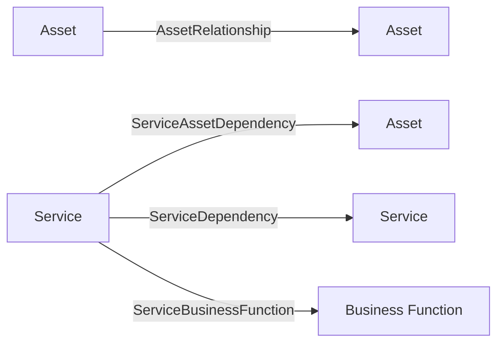

# Operational graph architecture

The operational graph is a typed, API-owned projection over accepted PostgreSQL
knowledge. It supplies the Knowledge Graph, Dashboard and focused Service and
Business Function views. The separate [dependency impact engine](dependency-analysis.md)
uses the same graph loaders and recorded dependency semantics to evaluate
hypothetical scenarios. Structural reachability alone does not imply failure.

The governing decision is [ADR 0001](../decisions/0001-shared-operational-graph.md).
PostgreSQL remains the source of truth; no graph database or persistent graph
copy is introduced. Manually curated knowledge works without a discovery source.
Observations must pass the existing acceptance/reconciliation boundary before
becoming operational graph content.

## Implementation and contracts

- `apps/api/app/services/operational_graph.py` owns identity, source loading,
  temporal filtering, authorization, traversal, metadata batching and adapters.
- `apps/api/app/routes/operational_graph.py` exposes validated graph reads.
- `apps/api/app/schemas.py` defines explicit graph node/edge/response contracts.
- `apps/web/lib/operational-graph.mjs` normalizes authorized responses;
  `operational-graph-view.js` presents them without authoritative inference.

The builder accepts a `Principal`, `ActiveContext` and explicit projection request.
It is testable independently of frontend rendering and HTTP request handling.
Focused compatibility profiles preserve existing Service/Business Function
response shapes and expansion behaviour while sharing scope and temporal rules.

```text
GET /api/operational-graph
GET /api/operational-graph/landscape
GET /api/services/{service_id}/graph
GET /api/business-functions/{function_id}/graph
POST /api/dependency-analysis
```

The focused generic read requires `focus_type` (Asset, Service or Business
Function) and `focus_id`. `max_depth` defaults to 1 and is bounded to 0–3;
`node_limit` defaults to 250 and is bounded to 1–500. `direction` is `incoming`,
`outgoing` or `both`; optional `edge_family` values select supported families.
`site_viewpoint=true` uses the selected Customer as the read context while
retaining per-object authorization. It requires a Customer and changes no
record ownership. Default reads retain their narrower context semantics.

The landscape provides a selected Customer/Site overview, including eligible
customer-wide records and directly related authorized providers. It caps results
at 500 nodes and 2,000 relationships. Remote providers do not seed unrestricted
expansion of another Site. See [operational views](homelab-operations-experience.md).

## Source model



| Record | Graph meaning |
| --- | --- |
| Asset and AssetRelationship | Technical nodes and current recorded structural relationships. |
| Service and temporal Service dependencies | Operational capability and Service→Asset or Service→Service links. |
| DependencyGroup and Membership | Versioned requirement, `all`/`any` strategy and failure effect for a Service need. Underlying dependencies remain authoritative relationships. |
| BusinessFunction and ServiceBusinessFunction | Business context supported by Services; no synthetic availability/completeness. |
| RelationshipType | Managed keys, endpoint applicability, labels and direction. |
| Knowledge summaries, gaps and assertions | Bounded authorized qualifiers, preserving accepted-versus-observed distinction. |

Archived Services, inactive Business Functions and tombstones are excluded from
the generic current projection. Focused compatibility routes may permit an
inactive focus for historical detail access; tombstones stay excluded.

## Stable identity and metadata

Node keys use durable type plus UUID:

```text
asset:<uuid>
service:<uuid>
business_function:<uuid>
```

Edges use durable family plus underlying relationship UUID:

```text
asset_relationship:<uuid>
service_asset:<uuid>
service_service:<uuid>
service_business_function:<uuid>
```

Names, layout order and frontend array positions never determine identity.
Nodes retain their underlying UUID, scope, name, subtitle, route, lifecycle and
recorded operational state. Authorized criticality, completeness/gap metadata,
source and update time are optional. Additional presentation fields provide
bounded icon/accent identity, Site name, requirement totals and Interface-owned
IP/VLAN context. Business Function completeness stays null.

Edges retain canonical `source_key`/`target_key`, family/ID, managed type and
label, temporal validity, `required_for_operation`, dependency group identity,
strategy/requirement/effect and accepted knowledge state. Full raw evidence,
custom fields and arbitrary notes remain in detail APIs rather than unbounded
graph serializers. Response metadata contains `focus_key`, `generated_at`,
`requested_depth`, `truncated`, warnings, nodes and edges.

## Direction and dependency meaning

Keep stored direction, semantic direction, traversal direction and visual
presentation separate. Reverse traversal follows incoming relationships without
swapping canonical endpoints or changing the Relationship Type. An inverse
label is presentation wording, not a new edge.

Service dependencies point from **dependent Service → provider**. `runs_on`
and other structural Asset relationships do not automatically become failure
propagation rules. The graph exposes recorded semantics but calculates no
consequences; the separate analysis engine owns that evaluation.

Grouped Service dependencies expose required/optional, `all`/`any` and explicit
unavailable/degraded/unknown effects. Ungrouped edges retain
`required_for_operation`, derive their requirement, have no group strategy and
return an unknown failure effect. No unavailable result is inferred from a
Required flag alone. See [dependency semantics](service-dependencies.md).

## Temporal validity, traversal and determinism

Capture one request time for all eligibility and metadata work. Temporal links
are current when:

```text
valid_from <= request_time
and (valid_to is null or valid_to > request_time)
```

Ended and future links are excluded without deleting history. Asset relationships
use current accepted records because their model has no equivalent temporal
history contract. Caller-selected historical reconstruction is not implemented.

Traversal resolves and authorizes the focus, batch-loads eligible frontier
edges/endpoints, adds each stable node/edge once and queues unvisited nodes until
depth or result bounds stop it. A visited set prevents infinite loops while
preserving edges between already-present nodes. Legitimate Service cycles are
allowed. Sort nodes/edges by stable keys and handle frontier limits deterministically.
Depth is a projection/display bound, separate from analysis propagation bounds.

Metadata and summaries are loaded in batches; avoid one query per node or edge.
The graph does not depend on a Redis cache. Any future optimization must retain
endpoint authorization and safe truncation.

## Authorization and non-disclosure

Existing permission keys and global/customer/site assignments are authoritative.
Focus resolution returns the established non-disclosing response when hidden.
Each expansion checks both endpoints and the relationship's permissions. Omit
an edge when either endpoint is inaccessible; never return dangling IDs, labels,
hidden counts, paths, warnings or summaries that reveal inaccessible entities.
Reverse traversal enforces the same boundary. Active workspace context narrows
a read but does not substitute for object checks.

A principal with Asset access but no Service permission receives only the allowed
projection. Truncation and warnings describe authorized results, never inaccessible
record existence. No graph-specific parallel authorization model is introduced.

## Analysis and extension boundaries

The analysis engine uses an internal completion profile to follow incoming
Service dependencies and complete outgoing sibling dependency sets for reached
Services. It reuses graph identity, authorization, captured time and group
metadata. Its result is a separate read-only output with hypothetical states,
structured reasons and actual canonical explanation paths.

Quorum, minimum counts, weighted/conditional rules, richer recovery evidence,
business-impact scoring and proposed-change overlays remain additive future
work. Proposed-change simulation must not mutate accepted operational records
or add scenario flags to them as a shortcut. New metadata must preserve durable
identity and existing focused contracts.

Live integration operation remains independent of graph reads. The projection
does not certify Asset responsiveness, Service health, backup success, RTO,
change safety or recovery readiness. Those claims need suitable evidence and
explicit analysis semantics.

## Presentation contracts

Graph rendering may choose layout, grouping, labels, focus, filters and interaction
state over authorized responses. It may not reconstruct missing membership,
failure effects or scope from raw database-shaped data.

A group with one distinct relationship in the acquired authorized projection
renders as its original direct edge. Two or more retain an intermediate ALL/ANY
marker. Member counts are captured before presentation filtering/disclosure, so
hiding one visible edge does not flatten a known two-member group. Counts describe
the acquired projection, not total or undisclosed membership. A bounded read with
only one member can consequently appear direct; no hidden count is requested.

Direct edges retain group metadata, stable identity and canonical endpoints.
Details are available through the inspector and Recorded relationships disclosure.
Markers are presentation objects, not new persisted operational entities.

Three lanes separate Business Functions, Services and Assets. Deterministic layout
keeps shared Assets once, places provider groups together and uses separate
routing for same-lane Service dependencies. Layout never changes meaning. Narrow
viewports scroll rather than shrinking text. Authored names remain readable;
legacy UUID-style group names get display-only friendly fallbacks without
rewriting stored names or history.

Dashboard ingestion normalizes `source_key` and `target_key` once. Optional
`source` is provenance text, not a node. Null/malformed and dangling records are
excluded, never reconstructed. Widgets and attention counts use that same
normalized authorized set.

## Regression expectations

Graph tests cover durable identity, semantic direction, forward/reverse traversal,
depth/result bounds, cycles, duplicate suppression, deterministic ordering,
temporal boundaries, unauthorized focus, hidden endpoints, tenant isolation,
metadata non-disclosure, compatibility adapters and representative query efficiency.
Analysis tests separately verify dependency evaluation and explanation safety.
